# SmartEgg: Incubadora Inteligente Io - Grupo 7

## 1. Descripción de la solución.  
La Facultad de Ciencias Agronómicas de la USAC identificó que los pequeños productores avícolas de la región experimentan pérdidas del 30% al 40% en sus procesos de incubación debido a factores críticos: control manual e impreciso de temperatura y humedad, volteo inconsistente de los huevos, falta de monitoreo continuo y ausencia de registros digitales.

**SmartEgg** es una solución embebida e IoT diseñada como prototipo funcional para automatizar y optimizar el entorno de incubación:
- **Control Ambiental Automático:** Lectura en tiempo real de temperatura y humedad mediante un sensor digital (DHT11/DHT22), manteniendo el rango térmico óptimo de **37.0 °C a 38.0 °C** y humedad relativa entre **50% y 65%**.
- **Accionamiento por Umbrales:** Control de una fuente de calefacción (bombilla/celda peltier) y ventilación forzada mediante módulos de relé.
- **Rotación Automatizada:** Simulación del volteo periódico de huevos mediante servomotor ($\pm45^\circ$ cada ciclo).
- **Sistema de Alerta y Monitoreo Local:** Alarma sonora mediante buzzer ante anomalías y visualización en tiempo real en pantalla LCD 16x2 vía protocolo I2C.
- **Telemetría e Integración IoT:** Transmisión de datos serial UART/USB hacia un backend centralizado para persistencia en base de datos, visualización en dashboard web/móvil y exportación de reportes técnicos en PDF.

---
## Capas del Framework IoT.  
El sistema SmartEgg implementa una arquitectura estructurada en las 4 capas del modelo IoT:  
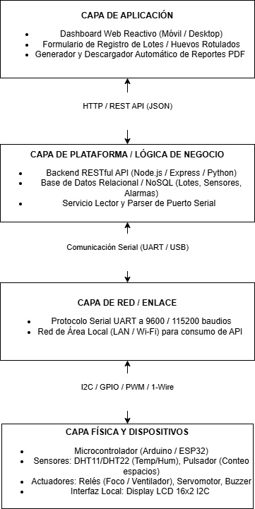

## Fotografías del prototipo (mockup, proceso de elaboración y prototipo final). 
### Mockups del Prototipo físico  


### Fotografías del proceso de elaboración  
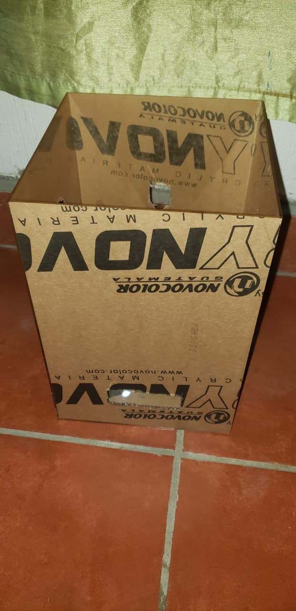  
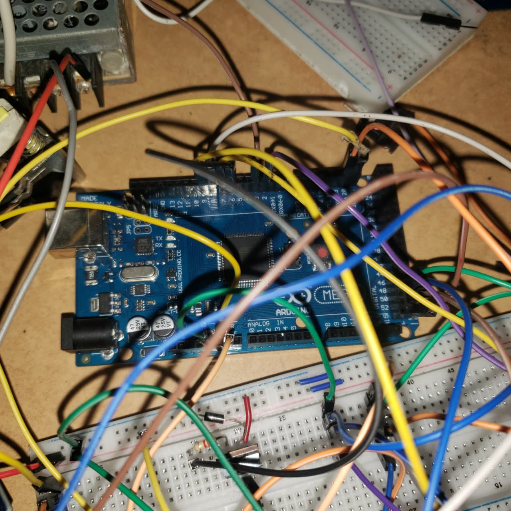  
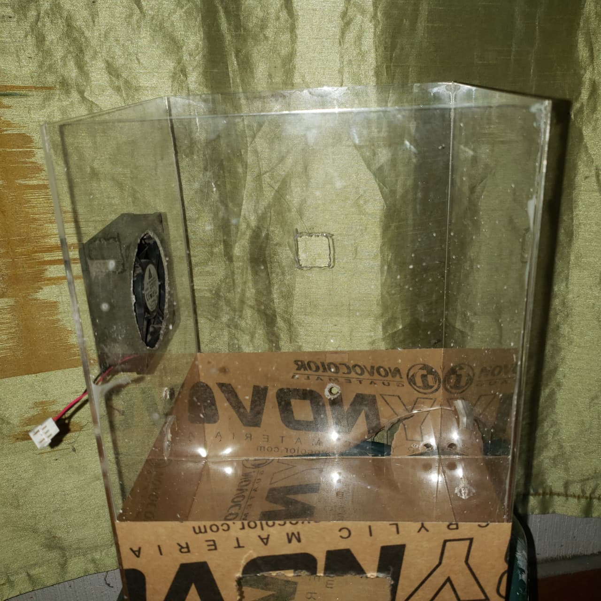  
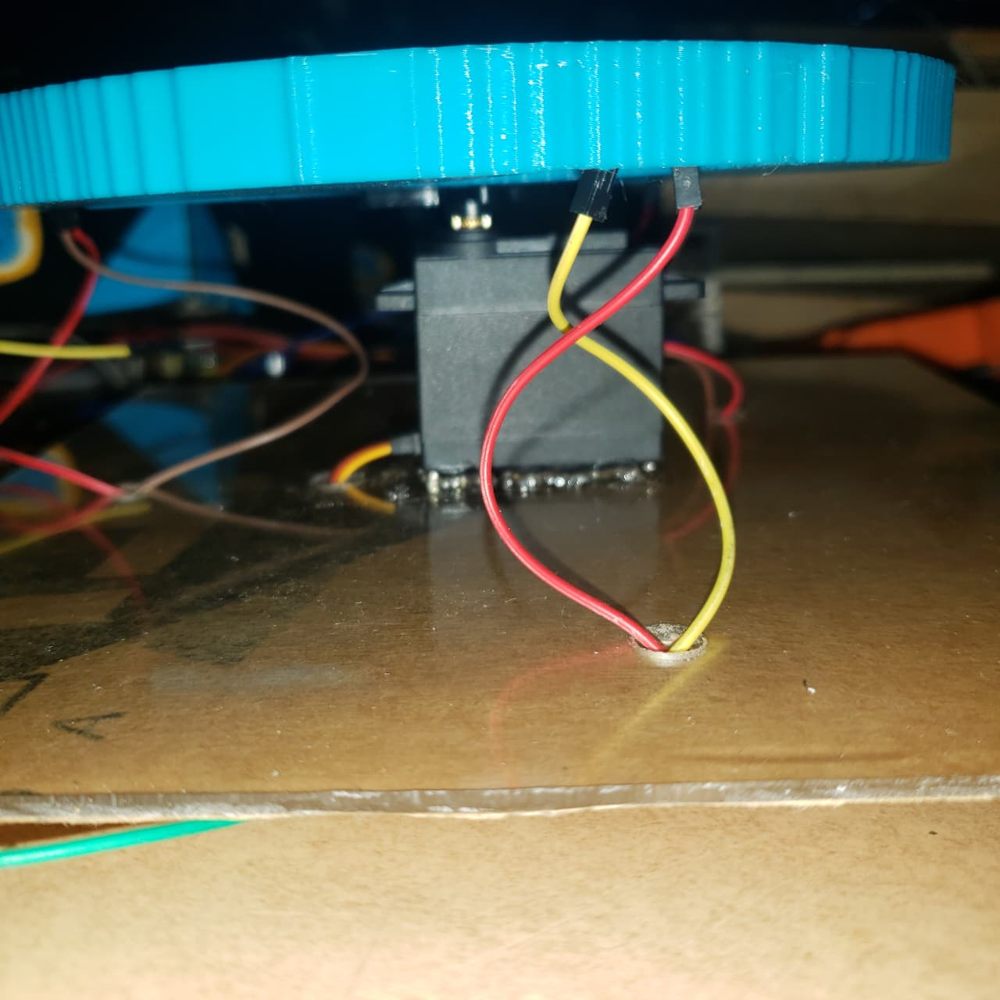  
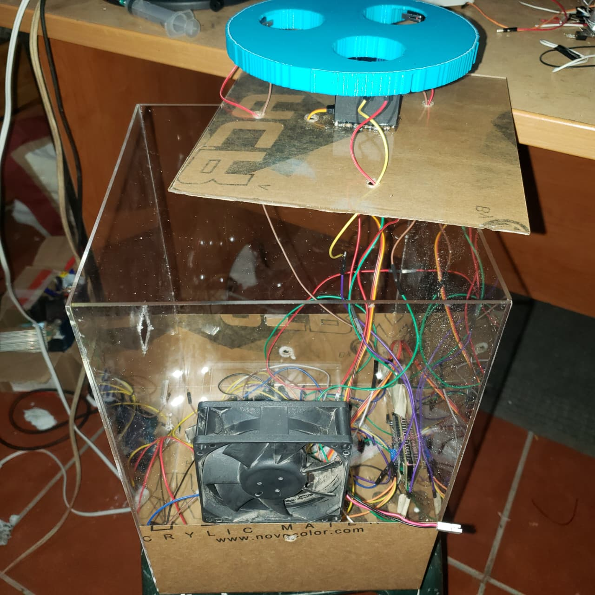  

### Fotografías del prototipo final  
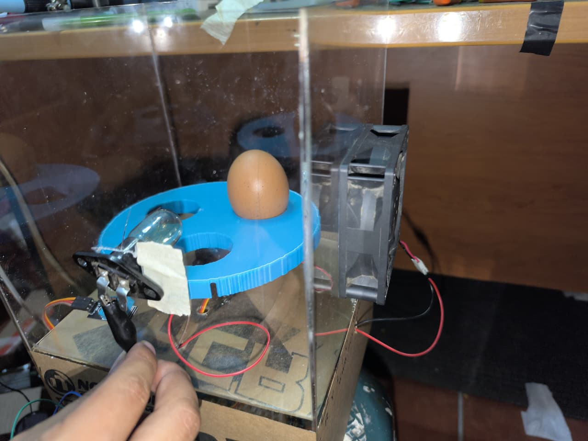  
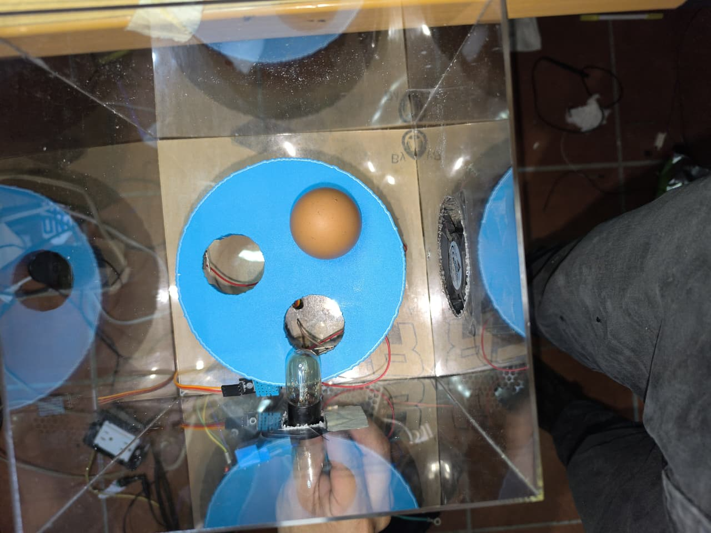  


## Mockups de la Aplicación Web/Móvil.  
A continuación se presentan los prototipos visuales de la plataforma IoT diseñados para entornos de escritorio y dispositivos móviles:  
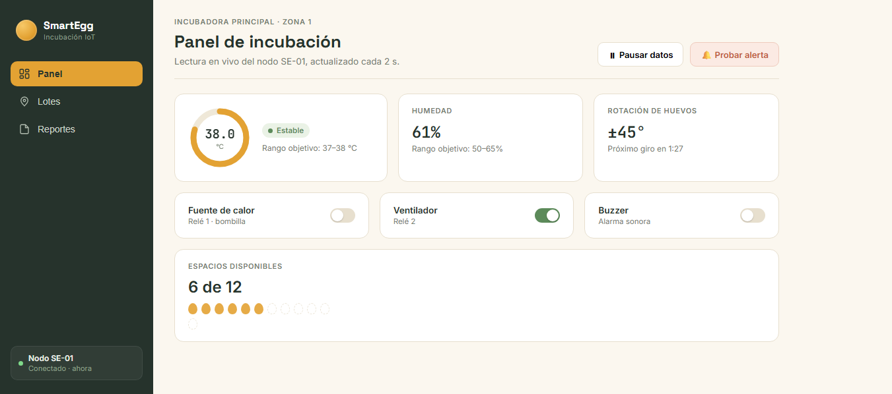  
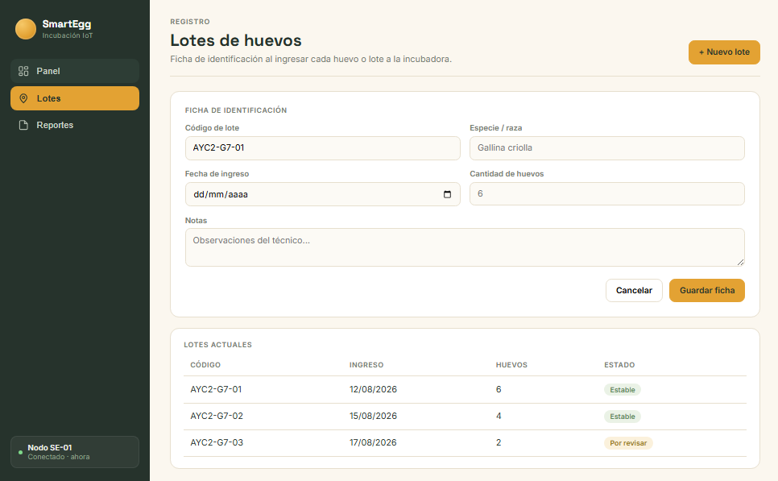   
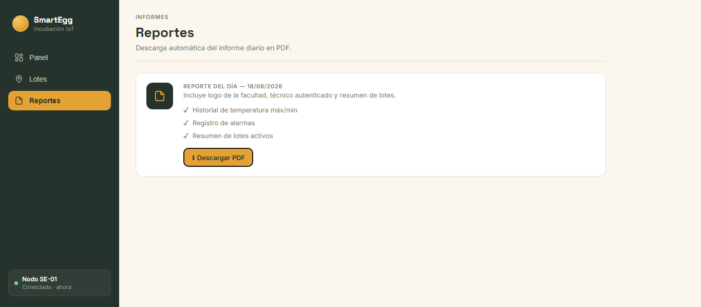  

## Diagrama de Conexiones
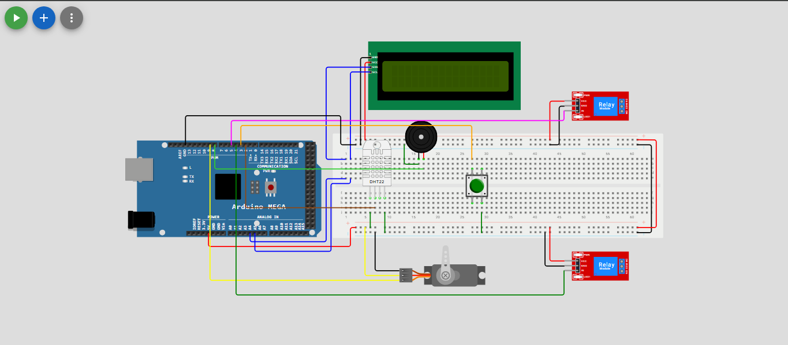  

## Diagrama de Arquitectura de Software.
El flujo de datos del ecosistema se distribuye de la siguiente manera:
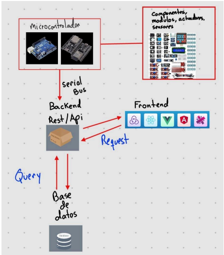

## Diagrama de Automatización  


## Documentación de la API 
La plataforma cuenta con un backend desarrollado en **Python (Flask)** que expone una API RESTful para la sincronización y persistencia de las lecturas del microcontrolador, la gestión de lotes/huevos de incubación, el registro de alarmas y la exportación de reportes.

* **Host Base:** `http://127.0.0.1:5000` (Red Local)
* **Formato de Comunicación:** `application/json` (salvo descargas de archivos)
* **Herramienta de Pruebas y Validación:** Postman

---

### Resumen de Endpoints Disponibles

| Método | Endpoint | Descripción | Código Éxito |
| :--- | :--- | :--- | :--- |
| `GET` | `/datos` | Obtiene la telemetría en tiempo real recibida por Serial. | `200 OK` |
| `GET` | `/historial` | Obtiene el historial de las últimas 100 lecturas ambientales. | `200 OK` |
| `POST` | `/huevo` | Registra un nuevo huevo/lote en la base de datos. | `201 Created` |
| `GET` | `/huevos` | Retorna el listado completo de huevos rotulados registrados. | `200 OK` |
| `GET` | `/alarmas` | Retorna el historial de las últimas 50 alertas del sistema. | `200 OK` |
| `GET` | `/reporte` | Genera y descarga el informe oficial en formato PDF. | `200 OK` |

---

### Detalle de Endpoints y Evidencias de Postman
#### 1. Obtener Telemetría en Tiempo Real
* **Ruta:** `GET /datos`
* **Descripción:** Retorna los valores más recientes enviados desde el microcontrolador a través del puerto serial (o el último registro guardado en base de datos si no hay dato en memoria).
* **Códigos de Respuesta:**
  * `200 OK`: Datos obtenidos con éxito.
  * `503 Service Unavailable`: `{"mensaje": "Sin datos aún"}` (sistema inicializando).

**Respuesta esperada:**  
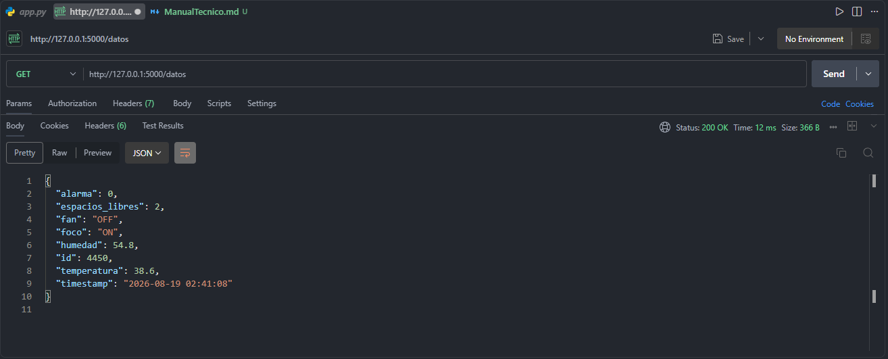

#### 2. Consultar Historial de Lecturas
* **Ruta:** `GET /historial`
* **Descripción:** Retorna una lista con las últimas 100 mediciones registradas de temperatura, humedad, estados de relés y conteo de espacios.
* **Códigos de Respuesta:**
  * `200 OK`: Datos obtenidos con éxito.

**Respuesta esperada:**  
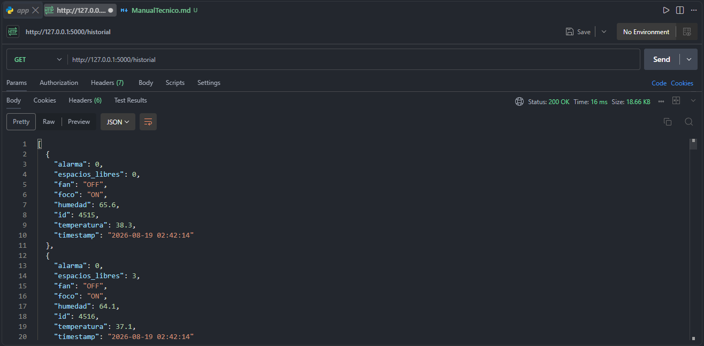

#### 3. Registrar Huevo / Ficha de Identificación
* **Ruta:** `POST /huevo`
* **Descripción:** Inserta un nuevo registro en la tabla de huevos rotulados para control y trazabilidad en la incubadora.
* **Encabezados requeridos:** `Content-Type: application/json`
* **Cuerpo de la Petición (Request Body):**  
```json
{
  "lote": "LOTE-2026-A",
  "etiqueta": "HUEVO-001",
  "tecnico": "Carlos Perez",
  "notas": "Temperatura inicial normal, sin fisuras."
}
```
* **Códigos de Respuesta:**
  * `201 Created`: `{"mensaje": "Huevo registrado"}`
  * `400 Bad Request`: `{"error": "Campo requerido: [nombre_campo]"}` (en caso de omitir lote, etiqueta o tecnico).

**Respuesta esperada:**  
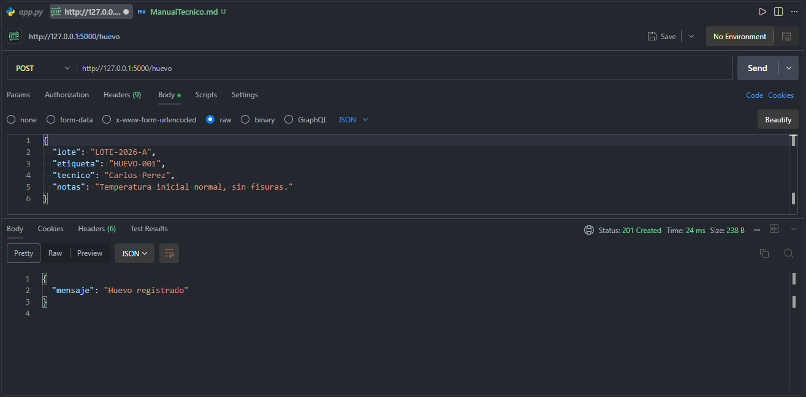

#### 4. Listar Huevos Registrados
* **Ruta:** `GET /huevos`
* **Descripción:** Consulta el inventario histórico de huevos/lotes ingresados a la incubadora, ordenados cronológicamente.
* **Códigos de Respuesta:**
  * `200 OK`: Datos obtenidos con éxito.

**Respuesta esperada:** 
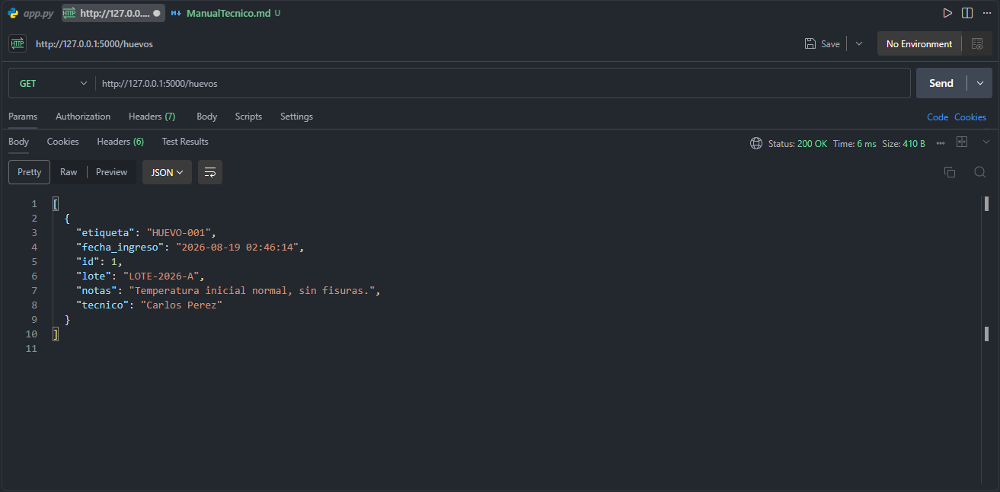

#### 5. Consultar Historial de Alarmas
* **Ruta:** `GET /alarmas`
* **Descripción:** Retorna el registro de las últimas 50 alertas generadas cuando las variables ambientales superan o caen por debajo de los umbrales configurados.
* **Códigos de Respuesta:**
  * `200 OK`: Datos obtenidos con éxito.

**Respuesta esperada:**  
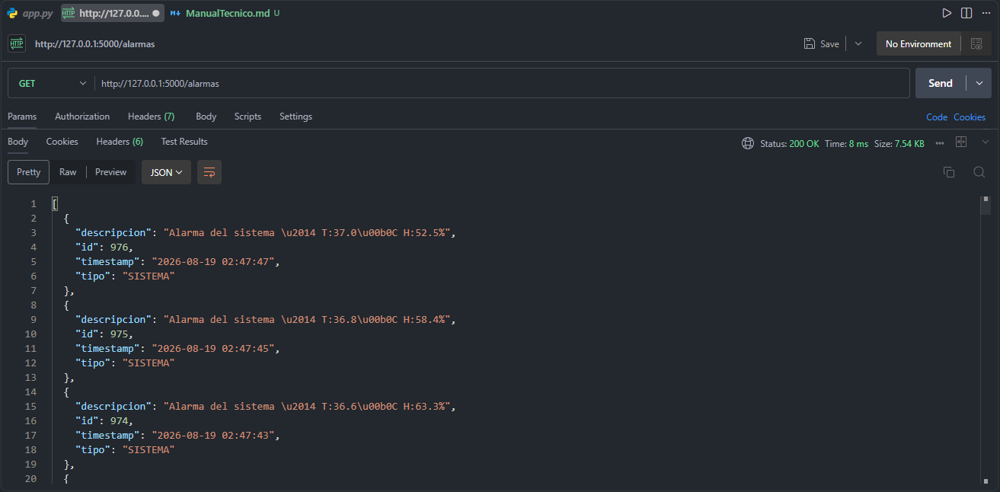

#### 6. Descarga de Reporte en PDF
* **Ruta:** `GET /reporte`
* **Descripción:** Compila en tiempo real y descarga un archivo PDF con el resumen de lotes, técnicos, estadísticas de temperatura/humedad y registro de alarmas.
* **Encabezados requeridos:** `Content-Type: application/pdf` y `Content-Disposition: attachment; filename=reporte_smartegg.pdf`
* **Códigos de Respuesta:**
  * `200 OK`: Datos obtenidos con éxito.

**Respuesta esperada:**  
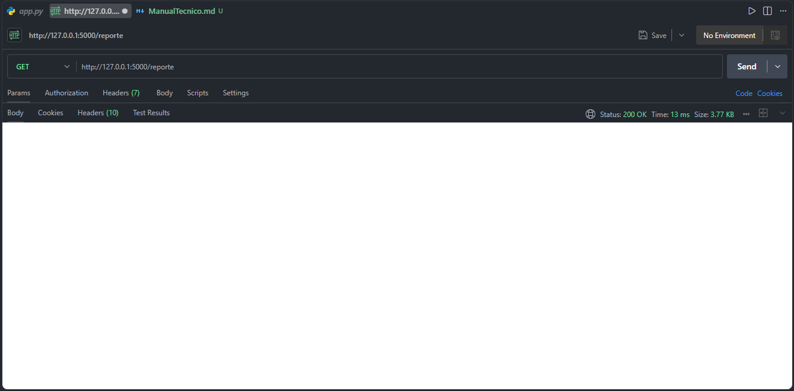


## Captura de github sobre los commits.  


