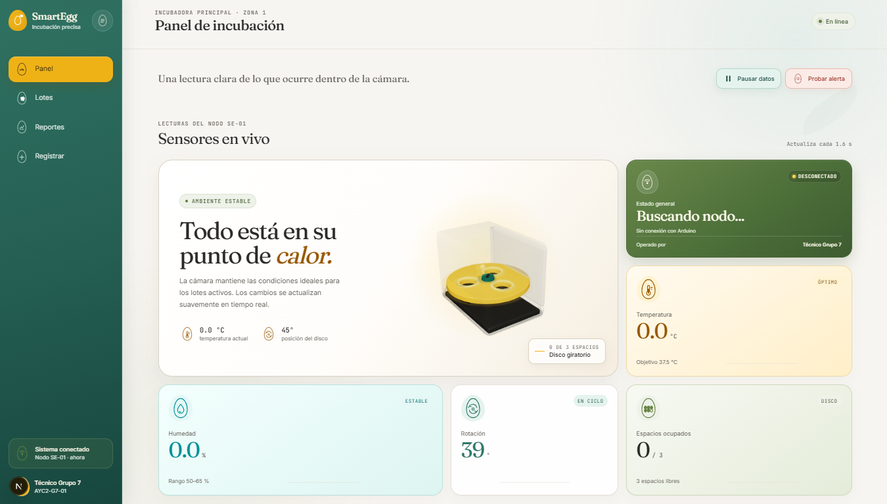
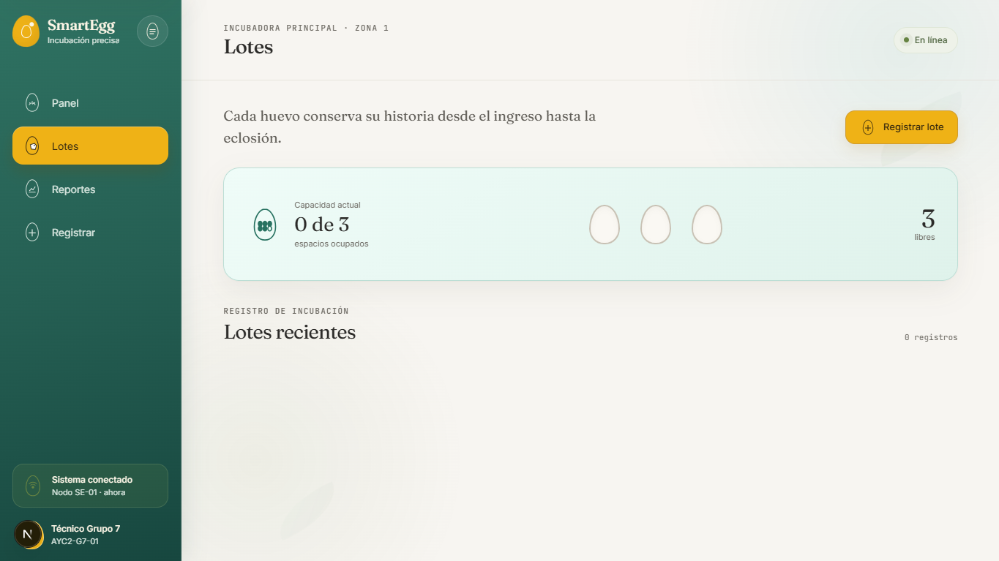
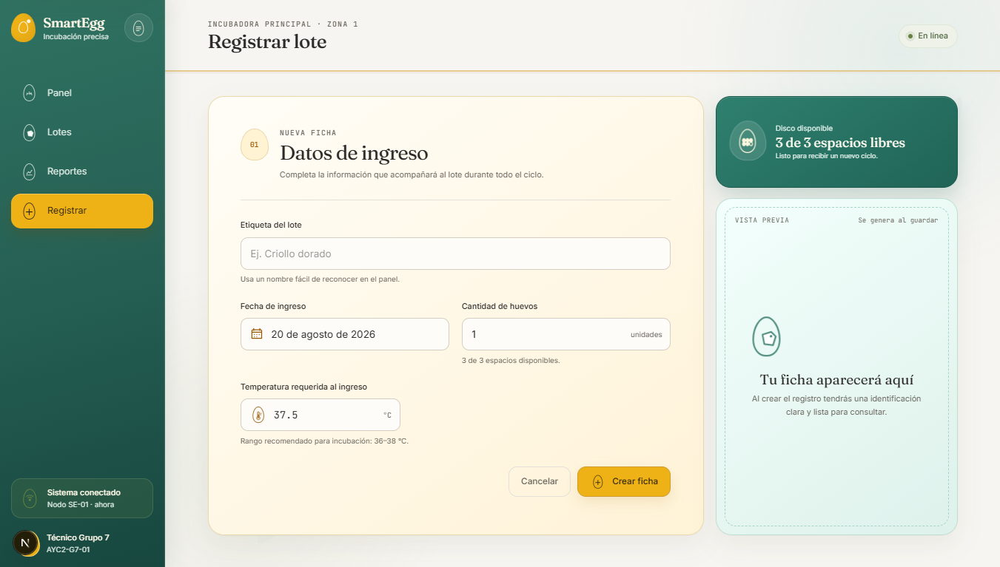
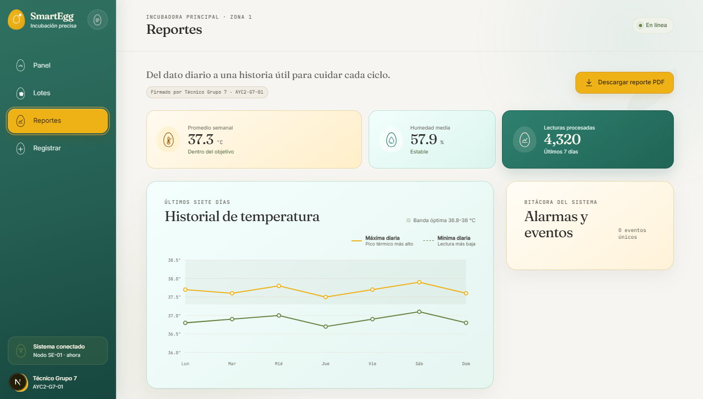

# Manual de Usuario de SmartEgg IoT

SmartEgg es una aplicación web para monitorear una incubadora inteligente, consultar los lotes registrados y generar reportes del ciclo de incubación. Esta versión está diseñada para ejecutarse en computadora o dispositivo móvil y tiene una capacidad máxima de tres huevos.

## 1. Requisitos y puesta en marcha

Para utilizar la aplicación se necesita:

- Node.js 22 o superior y npm 10 o superior para ejecutar el frontend.
- Python 3 y pip para ejecutar el backend cuando se utilice la lectura del Arduino.
- Arduino conectado por USB si se desea recibir telemetría del prototipo físico.

### 1.1 Ejecutar el backend

El backend Flask recibe las lecturas seriales, inicializa la base de datos y expone los datos que consulta la aplicación web.

1. Abra una terminal y entre a la carpeta del backend:

   ```bash
   cd Practica1/backend
   ```

2. Instale las dependencias:

   ```bash
   pip install -r requirements.txt
   ```

3. Conecte el Arduino por USB y ejecute el servidor:

   ```bash
   python app.py
   ```

   El servidor queda disponible en `http://localhost:5000`.

Si el Arduino o el backend no están disponibles, la interfaz sigue siendo navegable, pero el panel mostrará el estado `Desconectado` y no recibirá lecturas reales.

### 1.2 Ejecutar la aplicación web

1. Abra otra terminal y entre a la carpeta del frontend:

   ```bash
   cd Practica1/frontend
   ```

2. Instale las dependencias la primera vez:

   ```bash
   npm install
   ```

3. Inicie la aplicación:

   ```bash
   npm run dev
   ```

4. Abra `http://localhost:3000` en el navegador. La aplicación redirige al **Panel de incubación**.

## 2. Navegación general



La barra lateral contiene las cuatro secciones principales:

- **Panel:** muestra las lecturas y el estado general de la incubadora.
- **Lotes:** muestra la capacidad del disco y los lotes recientes.
- **Reportes:** presenta el historial, los indicadores y las alarmas del sistema.
- **Registrar:** abre el formulario para crear una ficha de incubación.

En pantallas medianas o pequeñas la navegación puede aparecer como una barra inferior. En escritorio, el botón de menú permite contraer o expandir la barra lateral.

La parte inferior de la barra lateral identifica el nodo (`SE-01`) y el técnico activo. En la parte superior de cada pantalla se muestra la zona `Incubadora principal · Zona 1` y el estado de conexión.

## 3. Panel de incubación

El **Panel** presenta las lecturas del nodo `SE-01` y se actualiza aproximadamente cada 1.6 segundos cuando existe conexión.

Las tarjetas principales muestran:

- **Estado general:** indica si el sistema está en línea o desconectado.
- **Temperatura:** lectura actual y objetivo de `37.5 °C`.
- **Humedad:** lectura actual y rango de referencia de `50–65 %`.
- **Rotación:** ángulo actual del disco y ciclo de `±45°`.
- **Espacios ocupados:** cantidad de huevos registrados frente a la capacidad total de tres espacios.
- **Escena de la incubadora:** representación visual del disco, su ángulo y la cantidad de espacios ocupados.

### Acciones del panel

- **Pausar datos:** congela temporalmente la actualización de las lecturas.
- **Reanudar:** vuelve a actualizar la telemetría después de pausar los datos.
- **Probar alerta:** activa el estado de demostración de alerta para observar cómo se presenta una temperatura elevada. Esta acción es solo de prueba.

## 4. Registro y consulta de lotes

### 4.1 Consultar lotes



En **Lotes** se muestra:

- La capacidad actual en formato `ocupados de 3`.
- La cantidad de espacios libres representada en el disco.
- El listado de **Lotes recientes**.
- La etiqueta, el identificador, el estado, la fecha de ingreso, la cantidad, la temperatura requerida y el progreso del ciclo.

Para crear un registro, seleccione **Registrar lote** o abra **Registrar** desde la navegación.

### 4.2 Crear una ficha de incubación



En la pantalla **Registrar lote**, complete los siguientes campos:

1. **Etiqueta del lote:** escriba un nombre reconocible, por ejemplo `Criollo dorado`. Debe tener entre 3 y 40 caracteres.
2. **Fecha de ingreso:** seleccione la fecha correspondiente. No se permiten fechas futuras.
3. **Cantidad de huevos:** indique una cantidad entre 1 y 3, sin superar los espacios disponibles.
4. **Temperatura requerida al ingreso:** indique un valor entre `36 °C` y `38 °C`. El valor inicial sugerido es `37.5 °C`.

Presione **Crear ficha** para guardar el registro. La vista previa mostrará la ficha creada con su etiqueta, identificador, fecha, cantidad y temperatura. El técnico se asigna automáticamente al registro actual.

Si no hay suficiente capacidad, el formulario muestra un aviso y no permite completar el registro. **Cancelar** vuelve a la lista de lotes; después de guardar se puede seleccionar **Registrar otro** para crear una nueva ficha.

## 5. Reportes



La sección **Reportes** reúne la información disponible del sistema:

- Promedio semanal de temperatura.
- Humedad media.
- Cantidad de lecturas procesadas durante los últimos siete días.
- Gráfica del **Historial de temperatura** con la banda óptima de `36.8–38 °C`.
- **Alarmas y eventos** registrados, con fecha, detalle, severidad e identificador.

Para generar el documento, presione **Descargar reporte PDF**. El navegador crea y descarga un archivo con los datos de telemetría, lotes, técnico y alarmas disponibles en la sesión. El PDF contiene texto seleccionable.

## 6. Funcionamiento del prototipo físico

Cuando el Arduino está conectado, el backend puede recibir las lecturas del prototipo por el puerto serial. El firmware controla la temperatura, la humedad, la rotación del disco y los actuadores definidos en el montaje físico.

Antes de encender el prototipo:

1. Verifique la alimentación de la incubadora y las conexiones del Arduino.
2. Coloque los huevos en el disco sin superar la capacidad de tres unidades.
3. Conecte el Arduino por USB a la computadora donde se ejecuta el backend.
4. Compruebe en el **Panel** que el estado cambie a `En línea` y que aparezcan lecturas.

Los umbrales de control, la pantalla LCD, el buzzer y los actuadores dependen del firmware y del montaje eléctrico. La aplicación web representa las lecturas recibidas; no sustituye las protecciones eléctricas ni el control local del prototipo.

## 7. Funcionamiento del Prototipo Físico y Maqueta (SmartEgg)

El nodo físico de la incubadora **SmartEgg** opera de manera autónoma mediante un microcontrolador que integra sensores, actuadores y lógica de control embebida para mantener las condiciones óptimas de incubación:

### 7.1. Control Térmico y Ambiental por Umbrales
* **Monitoreo Continuo:** El sensor digital (DHT11/DHT22) muestrea periódicamente la temperatura y la humedad relativa dentro del habitáculo.
* **Calefacción Automática:** Si la temperatura desciende por debajo del límite mínimo ($37.0\text{ }^\circ\text{C}$), el microcontrolador activa el módulo relé que conmuta la fuente de calor (bombilla incandescente / celda Peltier) para elevar la temperatura.
* **Ventilación Forzada:** Al superar el límite máximo ($38.0\text{ }^\circ\text{C}$), se apaga la calefacción y se activa el ventilador extractor para disipar el exceso de calor y recircular el aire.
* **Rango de Humedad:** El sistema verifica que la humedad permanezca en el intervalo del $50\%\text{ al }65\%$.

### 7.2. Mecanismo de Rotación Automatizada (Volteo de Huevos)
* **Accionamiento por Servomotor:** Para evitar que el embrión se adhiera a las paredes internas del cascarón, el servomotor acoplado a la bandeja circular realiza un giro periódico de $\pm45^\circ$.
* **Intervalo de Operación:** La rutina oscila la bandeja automáticamente cada 2 minutos en condiciones normales de producción.

### 7.3. Detección y Conteo de Espacios Disponibles
* **Finales de Carrera / Placas de Presión:** Cada cavidad de la bandeja 3D cuenta con un interruptor que detecta mecánicamente la presencia de un huevo.
* **Cálculo de Capacidad:** El microcontrolador cuantifica las posiciones ocupadas y calcula los espacios libres restantes para informar al usuario cuántos huevos adicionales pueden ingresarse.

### 7.4. Interfaz Local y Sistema de Alertas
* **Visualización en LCD 16x2 (I2C):** Muestra en tiempo real las lecturas de temperatura ($^\circ\text{C}$), porcentaje de humedad relativa, el estado de los actuadores y la cantidad de espacios libres.
* **Alarma Crítica (Buzzer):** Si se detecta una condición fuera de rango seguro (sobrecalentamiento crítico o humedad fuera de los límites establecidos), se acciona el buzzer emitiendo una señal sonora de advertencia.

### 7.5. Encapsulado y Transmisión de Telemetría
* **Aislamiento y Estética:** Todo el cableado, los módulos de relé y el microcontrolador permanecen ocultos en el compartimento inferior (casing cerrado), dejando visible únicamente la cámara transparente de acrílico y la salida USB.
* **Canal Serial (UART/USB):** El microcontrolador transmite las lecturas ambientales y los estados del sistema hacia la computadora central para su ingestión por el backend y visualización en el Serial Plotter.

## 8. Solución de problemas

- **Aparece `Desconectado`:** confirme que `python app.py` esté ejecutándose en el backend y que el Arduino esté conectado.
- **Las lecturas aparecen en cero:** espere a que el backend reciba el primer dato serial o revise la conexión del sensor.
- **No se puede registrar un lote:** revise que la etiqueta tenga al menos 3 caracteres y que existan espacios disponibles.
- **No se descarga el PDF:** permita las descargas del navegador y vuelva a presionar **Descargar reporte PDF**.
- **La página no abre:** confirme que el frontend esté ejecutándose con `npm run dev` y acceda a `http://localhost:3000`.