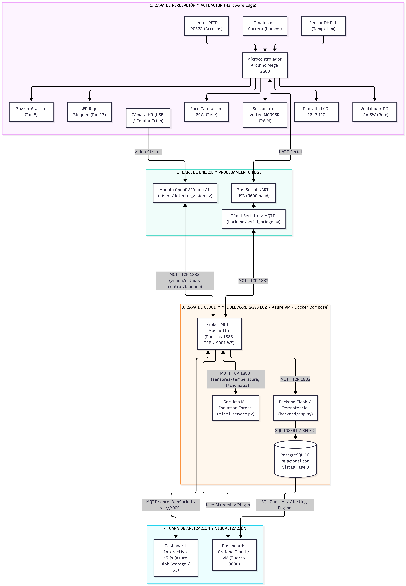
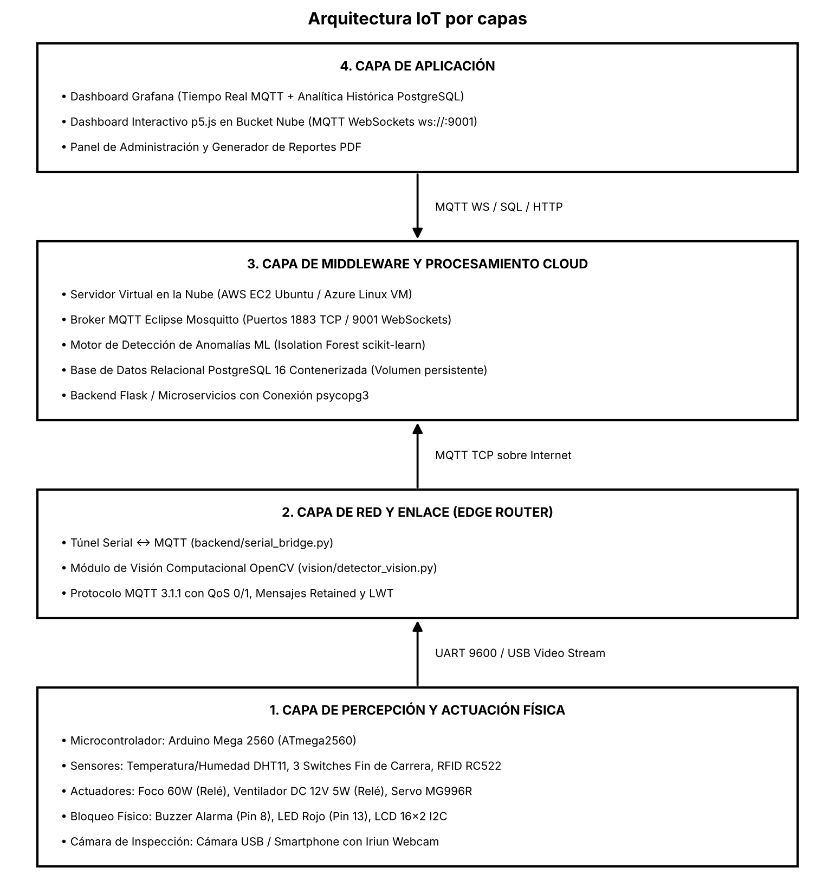
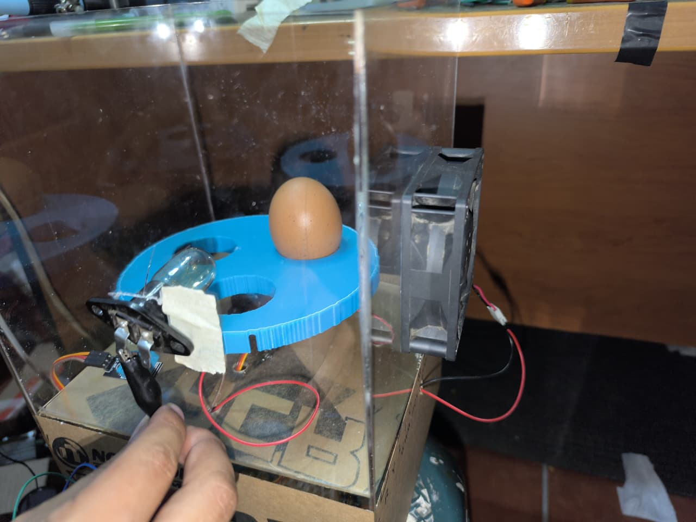
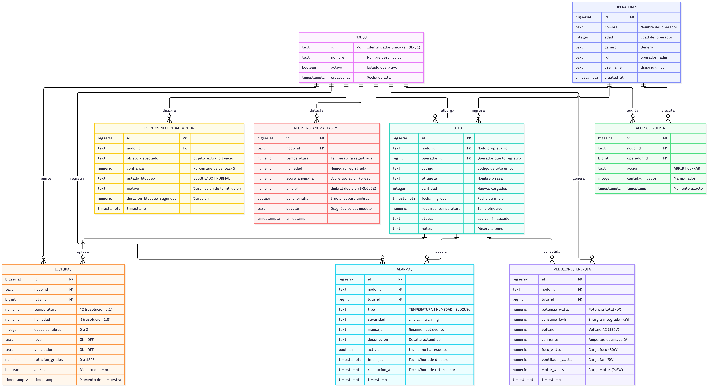
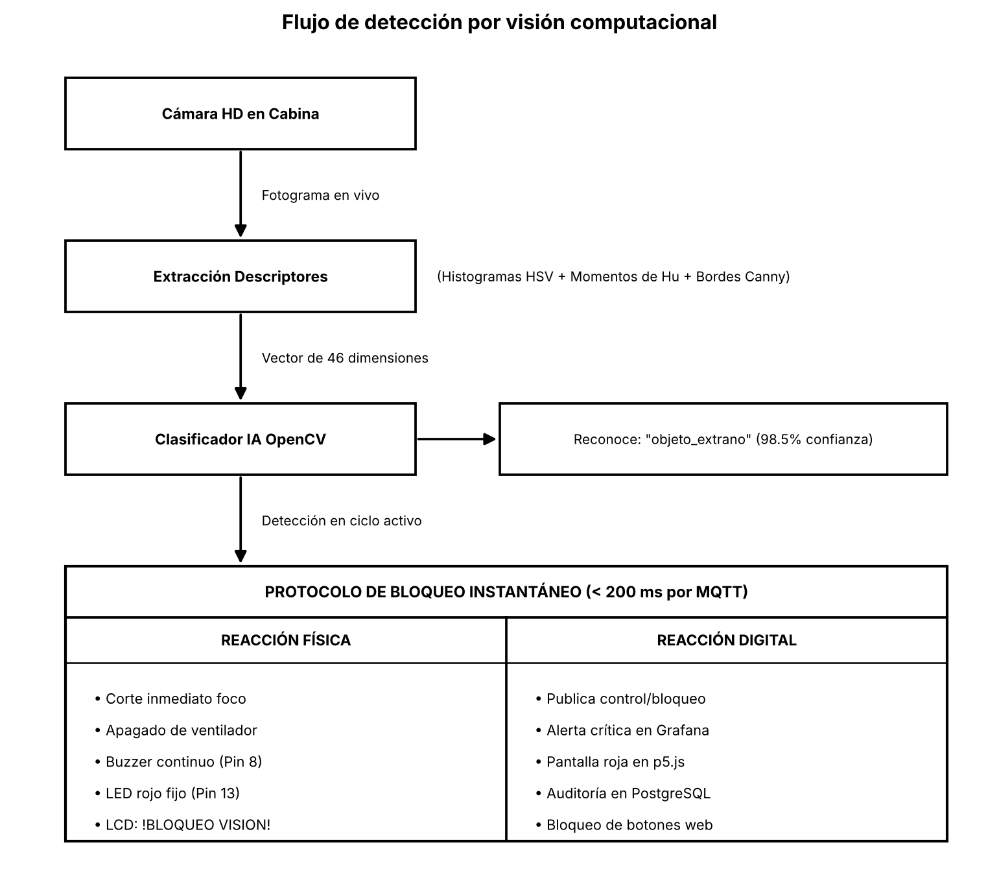

# SmartEgg IoT — Manual Técnico (Fase 3)

**Universidad de San Carlos de Guatemala**  
Facultad de Ingeniería — Escuela de Ciencias y Sistemas  
Arquitectura de Computadores y Ensambladores 2 — Segundo Semestre 2026  
Catedrático: Ing. Gabriel Alejandro Díaz  
Auxiliares: Josue Antonio Cux Barrientos, Marcos Geovani Josías Pérez Secay  
Grupo: **15**

---

## 1. Descripción de la Solución y Objetivos de la Fase 3

### 1.1 Contexto y Evolución del Sistema hacia la Fase 3
En las fases anteriores, el sistema **SmartEgg** se desarrolló como una incubadora avícola automatizada enfocada en la telemetría elemental y el control reactivo: lectura de temperatura y humedad ambiental (sensor DHT11), conmutación de actuadores térmicos mediante relés (foco calefactor y ventilador extractor), volteo mecánico mediante servomotor ($\pm45^\circ$), detección de presencia mediante interruptores mecánicos y un registro centralizado sobre una base de datos relacional y un broker MQTT local.

Sin embargo, ese esquema inicial presentaba tres limitaciones operativas críticas:
1. **Supervisión exclusivamente reactiva:** El sistema solo reaccionaba a fallas ambientales una vez que la temperatura o humedad ya se encontraban fuera de rango, sin capacidad de predecir desviaciones sutiles derivadas de desgaste mecánico o descalibración del sensor.
2. **Ceguera visual de bioseguridad:** El sistema era incapaz de reconocer qué había dentro de la cabina. Si un operario dejaba una herramienta (tijeras, pinzas metálicas), basura plástica o si ingresaba una plaga, el sistema encendía el foco calefactor a ciegas, arriesgando incendios, gases tóxicos y muerte embrionaria.
3. **Dependencia de infraestructura local:** La ausencia de una nube pública restringía la escalabilidad, la supervisión remota distribuida y la resiliencia del almacenamiento de métricas.

---

### 1.2 Objetivos Específicos de la Fase 3: Autonomía, Predicción y Nube
Para superar estas barreras, la **Fase 3** redefine a SmartEgg como un **sistema ciberfísico autónomo, predictivo y distribuido en la nube**, cumpliendo los siguientes objetivos específicos:
* **Percepción Visual y Bioseguridad Activa en el Edge:** Incorporar visión computacional en tiempo real con OpenCV para clasificar el estado del habitáculo (`huevo`, `objeto_extrano`, `vacio`) y ejecutar el bloqueo físico y digital inmediato ante cuerpos no autorizados al iniciar el ciclo de incubación.
* **Mantenimiento Predictivo con Machine Learning:** Desplegar un modelo de aprendizaje automático no supervisado (*Isolation Forest*) entrenado con scikit-learn, capaz de inferir desviaciones anómalas multivariables en tiempo real antes de que alcancen umbrales críticos de alarma física.
* **Gestión y Eficiencia Energética en Tiempo Real:** Integrar el modelado, cálculo y supervisión continua de potencia activa instantánea ($W$) y energía acumulada ($kWh$), con parametrización de límites de sobreconsumo de seguridad y temporizadores programados de desconexión.
* **Migración y Despliegue Cloud Distribuido (AWS / Azure):** Centralizar la persistencia, analítica y mensajería en una máquina virtual Linux en la nube con Docker Compose (Mosquitto MQTT, PostgreSQL 16, Backend Flask, ML Service y Grafana 12), complementado con hosting estático de alta disponibilidad en AWS S3 o Azure Blob Storage para el dashboard interactivo en p5.js.
* **Cumplimiento Estricto de la Restricción No-API para Actuadores:** Todo control bidireccional opera exclusivamente por MQTT (QoS 1, retain), reservando llamadas HTTP/REST únicamente a lecturas y generación de reportes PDF.

---

### 1.3 Restricción Técnica Crítica: Control Exclusivo por MQTT
> [!CAUTION] 
> Queda **estrictamente prohibido el uso de APIs REST para controlar sensores y actuadores (-100% de penalización en rúbrica)**.  
> Todo el control bidireccional (apertura/cierre de puerta, encendido/apagado de actuadores, órdenes de bloqueo de seguridad y temporizadores de energía) opera **únicamente a través del Broker MQTT público en la nube**.  
> Las llamadas HTTP/REST del backend quedan reservadas exclusivamente para consultas de sólo lectura (`GET /datos`, `GET /historial`) y la generación transaccional del reporte PDF.

---

### 1.4 Diagrama de Arquitectura General


---

### 1.5 Flujo de Datos Distribuido Extremo a Extremo
1. **Adquisición Físico-Mecánica:** El microcontrolador Arduino Mega 2560 muestrea cada 2 segundos las variables físicas de cabina y emite una trama JSON estructurada por UART (`{"temperatura": 37.5, "humedad": 58.0, "foco": "ON", "fan": "OFF", "rotacion_grados": 45, "espacios_libres": 0}`).
2. **Puente Edge a la Nube:** El script [`serial_bridge.py`](../backend/serial_bridge.py) recibe los datos seriales y los despacha mediante MQTT hacia el broker en la nube (`smartegg/SE-01/sensores/...` y `smartegg/SE-01/actuadores/estado`). A su vez, escucha el tópico `smartegg/SE-01/control/#` para traducir comandos MQTT a órdenes seriales (`CMD:BLOQUEAR`, `CMD:DESBLOQUEAR`).
3. **Inferencia Visual en Vivo:** De forma concurrente, el módulo [`detector_vision.py`](../vision/detector_vision.py) captura el fotograma de la cámara interna, extrae descriptores morfológicos y de color HSV (46 características) y clasifica la escena con el modelo entrenado. Si el ciclo está activo y detecta un `objeto_extrano`, publica de inmediato en `smartegg/SE-01/control/bloqueo` con `{bloquear: true}` y en `smartegg/SE-01/alarmas/critica`.
4. **Evaluación de Machine Learning:** El contenedor [`ml_service.py`](../ml/ml_service.py) en la nube escucha la telemetría, mantiene una ventana deslizante de 30 muestras (1 minuto) y evalúa el vector multivariable con el modelo *Isolation Forest*. Si el score supera el umbral optimizado (`-0.0052`), publica la alerta en `smartegg/SE-01/ml/anomalia`.
5. **Cálculo y Gestión de Energía:** Se calcula la potencia instantánea ($W$) con base en las especificaciones nominales de los actuadores activos (Foco 60W, Fan 5W, Motor 2.5W, Base 3W) e integra el consumo horario ($kWh$), publicando en `smartegg/SE-01/energia/consumo`.
6. **Observabilidad Simultánea:** 
   - **Grafana:** Muestra el streaming MQTT en vivo (15 paneles) y evalúa alertas unificadas sobre PostgreSQL cada 10 segundos.
   - **Dashboard p5.js:** Conectado por WebSockets (`ws://<IP>:9001`), renderiza la incubadora interactiva 2D/3D, controla el límite de potencia y se bloquea visualmente si se detecta un objeto intruso.

---

## 2. Capas del Framework IoT y Arquitectura Distribuida

La arquitectura distribuida interconecta cuatro planos operacionales a través de Internet:




### 2.1 Capa de Percepción y Actuación (Hardware)
Esta capa interactúa directamente con el ambiente físico de la cámara de incubación:
* **Microcontrolador:** Arduino Mega 2560 gestionando lectura de sensores, control de relés y la lógica de bloqueo autónomo.
* **Sensor de Temperatura y Humedad:** DHT11 en Pin Digital 2 (resolución de 0.1°C y 1% de humedad relativa).
* **Sensor de Ocupación:** 3 interruptores de fin de carrera en pines analógicos A0, A1 y A2 conectados a la bandeja rotatoria.
* **Módulo RFID:** RC522 sobre bus SPI (Pines 5, 53, 50, 51, 52) para control de acceso de operadores autorizados mediante llavero RFID.
* **Actuador Calefactor:** Relé optoacoplado de 1 canal en Pin 7 gobernando un foco incandescente de $60\text{ W} / 120\text{ VAC}$.
* **Actuador de Alivio Térmico:** Ventilador DC 12V ($5\text{ W}$) en Pin 6 mediante relé/transistor.
* **Mecanismo de Volteo de Huevos:** Servomotor metálico MG996R en Pin 9 con ciclo de inclinación a $\pm45^\circ$ cada 60 segundos.
* **Dispositivos de Bloqueo y Alarma Física:**
  - Buzzer sonoro de alta frecuencia en Pin 8.
  - Señal luminosa crítica en LED de Pin 13.
  - Pantalla LCD 16x2 con adaptador I2C (dirección `0x27`) que exhibe de inmediato `!BLOQUEO VISION! OBJETO INVALIDO` ante un bloqueo.
* **Cámara de Video:** Dispositivo de captura en tiempo real (cámara USB o smartphone montado apuntando al interior del nido a través de *Iriun Webcam*).



---

### 2.2 Capa de Red y Conectividad (MQTT)
La comunicación IoT es **100% asíncrona y orientada a eventos**, utilizando el protocolo **MQTT 3.1.1**:
* **Broker Central:** Eclipse Mosquitto 2.0 corriendo en la máquina virtual Linux de la nube.
* **Puertos Expuestos:**
  - `1883 TCP`: Para enlaces M2M entre el nodo físico (túnel serial), el módulo de visión, el microservicio ML y el backend.
  - `9001 WebSocket`: Para el streaming directo hacia los clientes web en el navegador (Grafana y dashboard p5.js).
* **Políticas de Resiliencia:**
  - **QoS 1:** Utilizado en actuadores, alarmas críticas, eventos de bloqueo y puerta para garantizar al menos una entrega (*At least once*).
  - **Retained Messages:** Usados en `status`, `actuadores/estado`, `control/bloqueo` y `ml/anomalia`, permitiendo que cualquier cliente que se conecte reciba el último estado inmediatamente.
  - **Last Will and Testament (LWT):** El broker publica automáticamente `{"estado":"offline","valor":0}` en `smartegg/SE-01/status` si el nodo o el túnel pierden conexión abruptamente.

---

### 2.3 Jerarquía Completa de Tópicos MQTT del Sistema

A continuación se detalla la tabla de todos los tópicos del sistema, divididos entre los tópicos heredados de Fase 2 y los **4 nuevos tópicos requeridos para la Fase 3**, especificando para cada uno su QoS, estado de Retención, **Tipo de Dato**, Publicador, Suscriptores y Estructura formal del Payload:

| Tópico MQTT | QoS | Retained | Tipo de Dato | Publicador | Suscriptores | Estructura del Payload JSON / Valores |
| :--- | :---: | :---: | :--- | :--- | :--- | :--- |
| **`smartegg/SE-01/status`** *(Heredado)* | 1 | Sí | `JSON {nodo_id: string, estado: string, valor: int, timestamp: string}` | Backend / LWT Mosquitto | Grafana, Frontend, p5.js | `{"nodo_id":"SE-01","estado":"online","valor":1,"timestamp":"2026-10-22T10:00:00Z"}` *(offline en LWT)* |
| **`smartegg/SE-01/sensores/temperatura`** *(Heredado)* | 0 | No | `JSON {nodo_id: string, valor: float, unidad: string, timestamp: string}` | Túnel Serial / Backend | Grafana, Frontend, ML | `{"nodo_id":"SE-01","valor":37.5,"unidad":"°C","timestamp":"2026-10-22T10:00:00Z"}` |
| **`smartegg/SE-01/sensores/humedad`** *(Heredado)* | 0 | No | `JSON {nodo_id: string, valor: float, unidad: string, timestamp: string}` | Túnel Serial / Backend | Grafana, Frontend, ML | `{"nodo_id":"SE-01","valor":58.0,"unidad":"%","timestamp":"2026-10-22T10:00:00Z"}` |
| **`smartegg/SE-01/sensores/lectura`** *(Persistencia)* | 1 | No | `JSON {nodo_id: string, temperatura: float, humedad: float, foco: string, ...}` | Túnel Serial (`serial_bridge.py`) | Ingestor BD (`mqtt_ingestion.py`) | `{"nodo_id":"SE-01","temperatura":37.5,"humedad":58.0,"foco":"ON","fan":"OFF",...}` |
| **`smartegg/SE-01/actuadores/estado`** *(Heredado)* | 1 | Sí | `JSON {nodo_id: string, foco: string, ventilador: string, rotacion_grados: float, espacios_libres: int}` | Túnel Serial / Backend | Grafana, Frontend, ML, Gestor Energía | `{"nodo_id":"SE-01","foco":"ON","ventilador":"OFF","rotacion_grados":45.0,"espacios_libres":0}` |
| **`smartegg/SE-01/alarmas/critica`** *(Heredado)* | 1 | Sí | `JSON {id: string, tipo: string, severidad: string, mensaje: string, activa: boolean}` | Backend / OpenCV | Grafana, Frontend, p5.js | `{"id":"ALM-01","tipo":"BLOQUEO_SEGURIDAD_VISION","severidad":"CRITICA","mensaje":"Objeto no autorizado detectado","activa":true}` |
| **`smartegg/SE-01/puerta/evento`** *(Heredado)* | 1 | No | `JSON {id: int, accion: string, operador_id: int, cantidad_huevos: int, timestamp: string}` | Túnel Serial (RFID RC522) | Grafana, Frontend | `{"id":1,"accion":"ABRIR","operador_id":1,"cantidad_huevos":0,"timestamp":"2026-10-22T10:00:00Z"}` |
| **`smartegg/SE-01/ciclo/control`** *(Heredado)* | 1 | Sí | `JSON {nodo_id: string, activo: boolean}` | Dashboard / Operador | Arduino (Serial), OpenCV | `{"nodo_id":"SE-01","activo":true}` |
| **`smartegg/SE-01/control/puerta`** *(Heredado)* | 1 | No | `JSON {nodo_id: string, accion: string, operador_id: int}` | Dashboard / Operador | Arduino (Serial Bridge) | `{"nodo_id":"SE-01","accion":"ABRIR","operador_id":1}` |
| **`smartegg/SE-01/vision/estado`** ⭐ *(NUEVO 1)* | 0 | No | `JSON {nodo_id: string, clase: string, confianza: float, bloqueado: boolean, motivo: string}` | OpenCV (`detector_vision.py`) | Grafana, Backend, p5.js | `{"nodo_id":"SE-01","clase":"huevo","confianza":0.985,"bloqueado":false,"motivo":"operacion_normal"}` *(Clases: huevo, objeto_extrano, vacio)* |
| **`smartegg/SE-01/control/bloqueo`** ⭐ *(NUEVO 2)* | 1 | Sí | `JSON {nodo_id: string, bloquear: boolean, motivo: string, alarma_fisica: boolean}` | OpenCV / Operador | Arduino (Serial), p5.js, Grafana | `{"nodo_id":"SE-01","bloquear":true,"motivo":"objeto_extrano_detectado","alarma_fisica":true}` |
| **`smartegg/SE-01/ml/anomalia`** ⭐ *(NUEVO 3)* | 1 | Sí | `JSON {nodo_id: string, anomalia: boolean, valor: int, score: float, umbral: float, temp: float}` | Microservicio ML (`ml_service.py`) | Grafana, p5.js, Backend | `{"nodo_id":"SE-01","anomalia":false,"valor":0,"score":-0.0125,"umbral":-0.0052,"temp":37.5}` |
| **`smartegg/SE-01/energia/consumo`** ⭐ *(NUEVO 4)* | 0 | No | `JSON {nodo_id: string, watts: float, potencia: float, kwh: float, limite_watts: float, alerta_consumo: boolean}` | Backend / Gestor Energía | Grafana, p5.js | `{"nodo_id":"SE-01","watts":68.5,"potencia":68.5,"kwh":0.142,"limite_watts":80.0,"alerta_consumo":false}` |
| **`smartegg/SE-01/control/energia`** *(Gestión)* | 1 | No | `JSON {limite_watts: float, temporizador_minutos: int, timestamp: string}` | Dashboard p5.js | Gestor Energía / Backend | `{"limite_watts":85.0,"temporizador_minutos":30,"timestamp":"2026-10-22T10:00:00Z"}` |
| **`smartegg/SE-01/control/actuadores`** *(Energía)* | 1 | Sí | `JSON {accion: string, motivo: string}` | Gestor Energía (`energy_service.py`) | Arduino (Serial Bridge) | `{"accion":"APAGAR","motivo":"temporizador_vencido"}` |

---

### 2.4 Capa de Middleware y Procesamiento en la Nube
El stack del servidor se orquesta mediante **Docker Compose** en una instancia virtual Linux (Ubuntu 22.04 LTS en AWS EC2 o Azure Virtual Machine):
1. **Contenedor `mosquitto`:** Imagen `eclipse-mosquitto:2` escuchando en `0.0.0.0:1883` (TCP) y `0.0.0.0:9001` (WebSockets).
2. **Contenedor `postgres`:** Imagen `postgres:16-alpine` con volumen persistente `postgres_data` y scripts de migración automáticos en `/docker-entrypoint-initdb.d/`.
3. **Contenedor `backend`:** Servicio Python 3.11 con Flask, `psycopg` (driver binario v3) y cliente MQTT resiliente.
4. **Contenedor `ml`:** Servicio de inferencia continua basado en scikit-learn que consume los tópicos de telemetría y evalúa cada muestra con el pipeline preentrenado.
5. **Contenedor `grafana`:** Imagen propia basada en Grafana 12 con el plugin oficial `grafana-mqtt-datasource 1.1.0` fijado y provisionamiento de fuentes, dashboards y reglas de alerta como código.

---

### 2.5 Capa de Aplicación y Visualización
* **Dashboards en Grafana Cloud / VM (`:3000`):** Dos tableros dedicados:
  - *Dashboard en tiempo real:* Flujo de datos MQTT sin retardo.
  - *Dashboard analítico histórico:* Consultas SQL sobre PostgreSQL con filtros de tiempo y selección de nodo.
* **Dashboard Interactivo en p5.js:** Alojado en un servicio de almacenamiento de objetos con sitio web estático (AWS S3 Bucket o Azure Blob Storage). Se comunica directamente con el broker de la nube vía WebSockets, brindando renderizado visual 2D/3D del habitáculo, diales de consumo eléctrico y control de bloqueo interactivo.

---

## 3. Documentación de la Base de Datos (Modelo Entidad - Relación)

### 3.1 Diagrama Entidad-Relación General

A continuación se presenta el modelo relacional completo actualizado para la Fase 3, incorporando tanto las tablas maestras heredadas como las tres nuevas tablas de inteligencia (`mediciones_energia`, `registro_anomalias_ml` y `eventos_seguridad_vision`):



---

### 3.2 Diccionario de Datos (Tablas de Inteligencia Fase 3)

#### Tabla: `mediciones_energia`
Almacena el registro continuo de consumo y potencia eléctrica calculada a partir de los estados de los actuadores y los modelos de carga.
* `id` (`BIGSERIAL`, PK): Identificador único secuencial.
* `nodo_id` (`TEXT`, FK `nodos.id`): Nodo de la incubadora asociada.
* `lote_id` (`BIGINT`, FK `lotes.id`, Nullable): Lote en incubación al momento del registro.
* `potencia_watts` (`NUMERIC(8,2)`): Potencia eléctrica total activa ($W$).
* `consumo_kwh` (`NUMERIC(10,4)`): Energía acumulada en kilovatios-hora ($kWh$).
* `voltaje` (`NUMERIC(6,2)`): Tensión nominal de red ($120.0\text{ V}$).
* `corriente` (`NUMERIC(6,3)`): Intensidad de corriente calculada en Amperios ($A$).
* `foco_watts` (`NUMERIC(6,2)`): Desglose de carga del calefactor ($60.0\text{ W}$ si `ON`, $0\text{ W}$ si `OFF`).
* `ventilador_watts` (`NUMERIC(6,2)`): Desglose de carga del extractor ($5.0\text{ W}$ si `ON`).
* `motor_watts` (`NUMERIC(6,2)`): Desglose del servomotor ($2.5\text{ W}$ en movimiento, $0.5\text{ W}$ en reposo).
* `timestamp` (`TIMESTAMPTZ`): Marca temporal en formato UTC / ISO 8601.

#### Tabla: `registro_anomalias_ml`
Bitácora de inferencias predictivas emitidas por el modelo *Isolation Forest*.
* `id` (`BIGSERIAL`, PK): Identificador único.
* `nodo_id` (`TEXT`, FK `nodos.id`): Identificador del nodo evaluado.
* `temperatura` (`NUMERIC(6,2)`): Temperatura al momento de la anomalía.
* `humedad` (`NUMERIC(6,2)`): Humedad relativa de cabina.
* `score_anomalia` (`NUMERIC(8,4)`): Puntuación de decisión continua (valores mayores indican mayor atipicidad).
* `umbral` (`NUMERIC(8,4)`): Umbral matemático de corte (`-0.0052`).
* `es_anomalia` (`BOOLEAN`): Bandera lógica de detección (`true` para anomalía).
* `detalle` (`TEXT`): Diagnóstico textual explicativo (ej. "Arranque en frío", "Calentamiento brusco").
* `timestamp` (`TIMESTAMPTZ`): Momento de la inferencia.

#### Tabla: `eventos_seguridad_vision`
Auditoría forense de eventos de intrusión visual y activación del protocolo de seguridad.
* `id` (`BIGSERIAL`, PK): Identificador único.
* `nodo_id` (`TEXT`, FK `nodos.id`): Nodo de incubación.
* `objeto_detectado` (`TEXT`): Etiqueta visual identificada (`objeto_extrano`, `vacio`).
* `confianza` (`NUMERIC(5,2)`): Nivel de certidumbre probabilística del clasificador ($0$ a $100\%$).
* `estado_bloqueo` (`TEXT`): Estado operativo (`BLOQUEADO`, `NORMAL`).
* `motivo` (`TEXT`): Descripción de la causa que detonó la alarma.
* `duracion_bloqueo_segundos` (`NUMERIC(8,2)`): Tiempo que el sistema permaneció deshabilitado.
* `timestamp` (`TIMESTAMPTZ`): Fecha y hora del evento.

---

### 3.3 Vistas de Compatibilidad y Resiliencia
Para garantizar que Grafana opere sin interrupciones aun si los módulos de hardware o compañeros de equipo cargan datos en distintos momentos, la base de datos implementa 3 vistas analíticas con lógica de *fallback*:
1. **`vista_mediciones_energia`:** Si la tabla `mediciones_energia` no tiene datos, calcula la potencia y los kWh integrados dinámicamente a partir de los campos `foco` y `ventilador` de la tabla `lecturas`.
2. **`vista_registro_anomalias_ml`:** Extrae las anomalías registradas; si la tabla está vacía, extrae las lecturas donde `alarma = true`.
3. **`vista_eventos_vision`:** Unifica la tabla de eventos de visión con las alarmas críticas registradas de tipo `BLOQUEO_SEGURIDAD_VISION`.

---

## 4. Documentación de API y Justificación "No-API" de Control

### 4.1 Cumplimiento Estricto de la Restricción: "Cero APIs REST para Control"
> [!IMPORTANT]
> **Justificación Arquitectónica del Esquema No-API para Control:**
> * **Penalización Académica:** La rúbrica del curso establece explícitamente una penalización del **-100% de la calificación** si se emplean APIs REST (HTTP POST/PUT/PATCH) para gobernar actuadores.
> * **Inadecuación de HTTP/REST para Control Ciberfísico:** El protocolo HTTP es síncrono, basado en petición-respuesta cliente-servidor (*request-response*) y sin estado (*stateless*). En un sistema ciberfísico crítico como SmartEgg:
>   - Una parada de emergencia por presencia de un objeto extraño requiere latencia submilisegundo y difusión simultánea (*multicast/broadcast*) a todos los clientes (Arduino, interfaz web, dashboards, buzzer físico). HTTP requeriría encadenar múltiples llamadas síncronas bloqueantes sujetas a timeouts de socket.
>   - La supervisión del estado del foco y ventilador por HTTP obligaría a un sondeo periódico continuo (*polling*), saturando el ancho de banda y la CPU del microcontrolador.
> * **Uso Exclusivo de MQTT sobre TCP y WebSockets:**
>   - **MQTT sobre TCP (Puerto 1883):** Utilizado para el intercambio M2M entre el nodo físico Arduino (túnel serial), el módulo de visión OpenCV, el microservicio ML y el backend. Permite entrega garantizada QoS 1, persistencia del último comando conocido (*Retained messages*) y notificación automática de caída del enlace (*Last Will and Testament*).
>   - **MQTT sobre WebSockets (Puerto 9001):** Utilizado por las aplicaciones de navegador (el dashboard interactivo en p5.js y el datasource oficial de Grafana). Permite a los clientes web suscribirse a tópicos y enviar comandos de energía y desbloqueo de forma nativa como clientes MQTT puros sin pasar por ningún endpoint HTTP intermedio.

---

### 4.2 Endpoints REST Exclusivos de Consulta y Reporte (OpenAPI 3.0)

El contrato formal OpenAPI 3.0 se localiza en [`docs/openapi.yaml`](openapi.yaml). Los endpoints REST del backend expuestos en el puerto 5000 (consumidos por el portal web en el puerto 3001) son **exclusivamente de lectura analítica y descarga de documentos**, respetando al 100% la prohibición de control:

| Método | Endpoint | Tipo de Operación | Descripción |
|---|---|:---:|---|
| GET | `/health` | Lectura / Monitor | Chequeo de salud de BD PostgreSQL, Broker MQTT y Túnel Serial |
| GET | `/datos` | Lectura Analítica | Última muestra de telemetría del nodo en BD |
| GET | `/historial` | Lectura Analítica | Muestras históricas de telemetría (parámetro `limit`) |
| POST | `/huevo` | Transaccional BD | Registro de nueva ficha de lote de incubación |
| GET | `/huevos` | Lectura Analítica | Listado de lotes históricos registrados |
| GET | `/alarmas` | Lectura Analítica | Listado de alarmas e intervalos de inicio/resolución |
| GET | `/operadores` | Lectura Analítica | Listado de operarios autorizados por RFID |
| GET | `/accesos-puerta` | Lectura Forense | Historial de aperturas/cierres físicos de cabina |
| GET | `/reporte` | Reportería Binaria | Generación y descarga al vuelo del reporte formal en PDF |

#### Especificación de Endpoints Principales:

##### 1. `GET /health`
* **Propósito:** Healthcheck para monitores de contenedores y orquestación.
* **Respuesta 200 OK:**
  ```json
  {
    "estado": "ok",
    "database": "up",
    "mqtt": "connected",
    "serial": "receiving",
    "timestamp": "2026-10-22T10:00:00Z"
  }
  ```

##### 2. `GET /datos`
* **Propósito:** Retorna la telemetría más reciente persistida en PostgreSQL.
* **Respuesta 200 OK:**
  ```json
  {
    "nodo_id": "SE-01",
    "temperatura": 37.5,
    "humedad": 58.0,
    "foco": "ON",
    "ventilador": "OFF",
    "rotacion_grados": 45.0,
    "espacios_libres": 0,
    "alarma": false,
    "timestamp": "2026-10-22T10:00:00Z"
  }
  ```

##### 3. `GET /historial?limit=50`
* **Propósito:** Recupera series temporales históricas para graficación.
* **Parámetros Query:** `limit` (entero, por defecto 100, máx 1000).
* **Respuesta 200 OK:** Arreglo JSON con los objetos históricos de telemetría.

##### 4. `POST /huevo`
* **Propósito:** Da de alta una ficha de lote de incubación en la base de datos (no activa actuadores).
* **Cuerpo de la Petición (JSON):**
  ```json
  {
    "lote": "LOTE-2026-01",
    "etiqueta": "Huevos Raza Rhode Island",
    "cantidad": 3,
    "tecnico": "Operador 1",
    "required_temperature": 37.5,
    "fecha_ingreso": "2026-10-22T08:00:00Z"
  }
  ```
* **Respuesta 201 Created:** `{"mensaje": "Lote registrado correctamente", "id": 1}`.

##### 5. `GET /reporte`
* **Propósito:** Compila dinámicamente un reporte ejecutivo formal en formato PDF con ReportLab.
* **Respuesta 200 OK:** Archivo binario `application/pdf` con encabezados `Content-Disposition: attachment; filename="reporte_smartegg_SE-01.pdf"`.

---

## 5. Scripts de Base de Datos para el Día de la Calificación Presencial

Las siguientes sentencias SQL están probadas y preparadas para ejecutarse directamente en la consola `psql` o en pgAdmin durante la sustentación ante el equipo docente para auditar cada componente de la Fase 3:

### 5.1 Telemetría y Actuadores en Tiempo Real
```sql
SELECT 
    timestamp AS "Fecha/Hora",
    temperatura AS "Temp (°C)",
    humedad AS "Humedad (%)",
    foco AS "Foco",
    ventilador AS "Ventilador",
    rotacion_grados AS "Ángulo Servo (°)",
    alarma AS "Alarma Activa"
FROM lecturas
WHERE nodo_id = 'SE-01'
ORDER BY timestamp DESC
LIMIT 10;
```

### 5.2 Bitácora de Eventos de Bloqueo por Visión Computacional
```sql
SELECT 
    timestamp AS "Fecha/Hora",
    objeto_detectado AS "Objeto Detectado",
    confianza AS "Nivel de Certeza (%)",
    estado_bloqueo AS "Estado del Sistema",
    motivo AS "Motivo del Disparo",
    duracion_bloqueo_segundos AS "Tiempo Bloqueado (s)"
FROM eventos_seguridad_vision
WHERE nodo_id = 'SE-01'
ORDER BY timestamp DESC
LIMIT 10;
```

### 5.3 Histórico de Incidentes y Anomalías Predictivas (Machine Learning)
```sql
SELECT 
    timestamp AS "Fecha/Hora",
    temperatura AS "Temp (°C)",
    humedad AS "Humedad (%)",
    score_anomalia AS "Score Isolation Forest",
    umbral AS "Umbral de Alerta",
    detalle AS "Diagnóstico Predictivo"
FROM registro_anomalias_ml
WHERE es_anomalia = true AND nodo_id = 'SE-01'
ORDER BY timestamp DESC
LIMIT 10;
```

### 5.4 Consumo Energético Total por Lote de Incubación
```sql
SELECT 
    l.id AS "ID Lote",
    l.lote AS "Código Lote",
    l.etiqueta AS "Descripción Lote",
    l.cantidad AS "Huevos",
    l.fecha_ingreso AS "Fecha Inicio",
    ROUND(SUM(m.consumo_kwh)::numeric, 4) AS "Energía Total (kWh)",
    ROUND(AVG(m.potencia_watts)::numeric, 2) AS "Potencia Media (W)",
    ROUND((SUM(m.consumo_kwh) * 1.50)::numeric, 2) AS "Costo Est. (GTQ)"
FROM lotes l
LEFT JOIN mediciones_energia m ON l.id = m.lote_id
WHERE l.nodo_id = 'SE-01'
GROUP BY l.id, l.lote, l.etiqueta, l.cantidad, l.fecha_ingreso
ORDER BY l.id DESC;
```

### 5.5 Consumo Energético Horario Integrado (Watts y kWh)
```sql
SELECT 
    date_trunc('hour', timestamp) AS "Hora",
    ROUND(AVG(potencia_watts)::numeric, 2) AS "Potencia Media (W)",
    ROUND(SUM(consumo_kwh)::numeric, 4) AS "Energía Consumida (kWh)",
    ROUND(AVG(corriente)::numeric, 3) AS "Corriente Media (A)"
FROM vista_mediciones_energia
WHERE nodo_id = 'SE-01'
GROUP BY 1
ORDER BY 1 DESC
LIMIT 12;
```

### 5.6 Duración de Alarmas Críticas Históricas
```sql
SELECT 
    tipo AS "Tipo Alarma",
    severidad AS "Severidad",
    mensaje AS "Descripción",
    inicio_at AS "Inicio",
    resolucion_at AS "Resolución",
    ROUND(EXTRACT(EPOCH FROM (COALESCE(resolucion_at, NOW()) - inicio_at)) / 60.0, 2) AS "Duración (min)"
FROM alarmas
WHERE nodo_id = 'SE-01'
ORDER BY inicio_at DESC
LIMIT 10;
```

### 5.7 Auditoría Forense de Accesos RFID a Cabina
```sql
SELECT 
    ap.timestamp AS "Fecha/Hora",
    COALESCE(op.nombre, 'Desconocido') AS "Operador",
    ap.accion AS "Acción Realizada",
    ap.cantidad_huevos AS "Huevos Declarados"
FROM accesos_puerta ap
LEFT JOIN operadores op ON op.id = ap.operador_id
WHERE ap.nodo_id = 'SE-01'
ORDER BY ap.timestamp DESC
LIMIT 10;
```

---

## 6. Explicación y Justificación del Valor Disruptivo

### 6.1 Identificación del Valor Disruptivo
El valor disruptivo de **SmartEgg Fase 3** radica en el **Módulo de Bioseguridad y Protección Preventiva basado en Visión Artificial por Computadora (OpenCV) acoplado a un Protocolo de Bloqueo Físico y Digital en Tiempo Real**, protegiendo la incubadora ante manipulación indebida o presencia de cuerpos extraños.



### 6.2 Justificación Técnica y Operacional
1. **El Problema en la Industria:** En granjas avícolas, centros de investigación y criaderos comerciales, las incubadoras industriales operan "a ciegas". Sus sistemas de control son puramente térmicos. Si un operador realiza una inspección o rotación manual y olvida un objeto ajeno (un cúter, tijeras de desinfección, termómetros de mercurio rotos, llaves o plástico), el foco calefactor (60W o resistencias de 200W) se enciende automáticamente para alcanzar los 37.5°C. El calor continuo sobre plásticos o metales extraños genera:
   - Focos de ignición e incendios en el nido.
   - Emanación de gases tóxicos que asfixian los embriones a través de la cáscara porosa.
   - Contaminación bacteriana cruzada irreversible.
2. **La Solución Disruptiva de SmartEgg:** Al presionar la orden de inicio de ciclo, la cámara interna examina la escena. Si detecta la presencia de un elemento que no coincide morfológica ni cromáticamente con un huevo fértil, **el sistema aborta el encendido térmico en menos de 200 milisegundos**.
3. **Bloqueo Holístico (Físico + Cloud):**
   - **Físico:** El relé del foco se fuerza a estado abierto (OFF), el buzzer emite un tono de advertencia ininterrumpido en Pin 8, el LED rojo del Pin 13 se fija en alto y la pantalla LCD muestra `!BLOQUEO VISION! OBJETO INVALIDO`.
   - **Nube y Dashboards:** Por MQTT se propaga el estado de bloqueo a Grafana (el panel de seguridad cambia a rojo crítico) y a la aplicación interactiva p5.js (la cabina digital se pinta de rojo y deshabilita los controles del operador).
4. **Desbloqueo Seguro Supervisado:** El sistema no reanuda la operación automáticamente. Exige que el operador retire físicamente el objeto extraño y envíe una orden explícita de desbloqueo, quedando cada segundo de bloqueo registrado en la tabla `eventos_seguridad_vision` para auditoría de calidad.
