## 11. Manual de Usuario del Sistema SmartEgg

Esta guía describe el uso de la plataforma web SmartEgg para consultar la telemetría de la incubadora, registrar lotes, controlar el acceso a la puerta, revisar alarmas y generar reportes.

---

### 11.1 Requisitos y acceso inicial

Antes de utilizar la plataforma, verifique que los servicios estén disponibles:

1. Inicie la infraestructura desde la carpeta `Proyecto_1`:

	```bash
	docker compose up -d
	```

2. Compruebe el estado de los servicios:

	```bash
	docker compose ps
	```

3. Abra un navegador moderno e ingrese a:

	```text
	http://localhost:3001
	```

	En un arranque local sin Docker, la dirección puede ser `http://localhost:3000`.

4. El sistema redirigirá a `/login` si no existe una sesión activa. Las credenciales disponibles para la demostración son:

	| Usuario | Contraseña | Rol |
	|---|---|---|
	| `admin` | `admin123` | Administrador |
	| `op1` | `op1pass` | Operador 1 |
	| `op2` | `op2pass` | Operador 2 |

5. Después de iniciar sesión, la aplicación conserva la sesión durante un día. Para terminarla, use **Cerrar sesión** en la barra lateral; en celular está disponible como botón de salida en la barra superior.

La navegación se adapta al rol del usuario. Todos los perfiles pueden consultar el Panel, Lotes, Reportes, Registrar lote y Perfil. Los operadores también disponen de **Puerta** y únicamente el administrador dispone de **Administración**.

**Evidencia de acceso:**

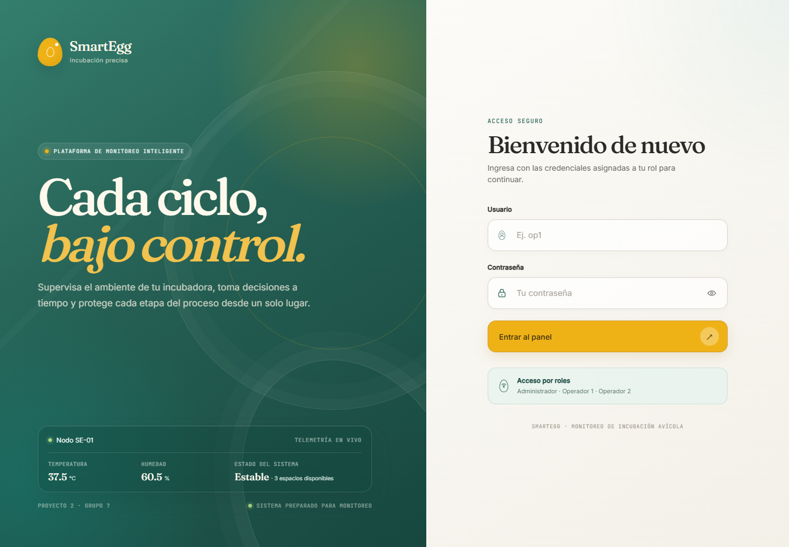

En celulares se muestra únicamente el formulario de acceso, con la identidad de SmartEgg y sin desplazamiento vertical.

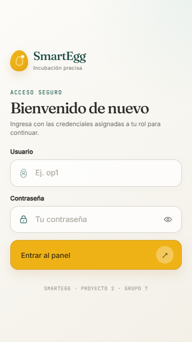

### 11.2 Elementos generales de la interfaz

La aplicación contiene una barra lateral y una barra superior:

- La barra lateral permite cambiar entre Panel, Lotes, Reportes, Puerta, Registrar lote, Perfil y, cuando corresponde, Administración.
- El botón de menú permite contraer o expandir la barra lateral.
- La barra superior muestra la sección actual, el estado del nodo `SE-01` y el centro de alarmas.
- El indicador **En línea** representa la disponibilidad del nodo según la telemetría recibida. Si el nodo no responde, se muestra **Desconectado**.
- En pantallas pequeñas se utiliza una navegación inferior.


### 11.3 Panel de monitoreo en vivo (`/dashboard`)

El Panel concentra las lecturas actuales de la incubadora.

#### Tarjetas de sensores

- **Temperatura:** muestra la temperatura actual en grados Celsius. El objetivo de referencia mostrado por la interfaz es `37.5 °C`.
- **Humedad:** muestra la humedad relativa y el rango de referencia `50–65 %`.
- **Rotación:** muestra la posición actual del servomotor. El ciclo de la bandeja utiliza posiciones de hasta `±45°`.
- **Espacios ocupados:** indica los huevos detectados respecto a la capacidad de tres espacios y muestra cuántos espacios están libres.
- **Estado general:** indica si el nodo está conectado y muestra el operador asociado a la sesión o a la telemetría.

Las tarjetas presentan los valores y su estado operativo; las tendencias históricas se consultan en los gráficos de Chart.js ubicados debajo.

#### Dashboard interactivo p5.js

En el encabezado del Panel, selecciona **Abrir dashboard p5.js**. Se abrirá en una pestaña nueva una interfaz de monitoreo independiente.

- Los botones **Temperatura**, **Humedad** y **Potencia** cambian la gráfica 2D dibujada con p5.js.
- Al pasar el cursor sobre la gráfica, se resalta una lectura y se muestra su valor.
- Las tarjetas laterales muestran las lecturas ambientales, la clasificación de visión, el resultado de ML, los actuadores y el consumo.
- El límite de potencia y el temporizador publican sus ajustes al broker MQTT. El botón de restablecimiento publica la orden MQTT para retirar un bloqueo.
- Si aún no llegan datos, la interfaz muestra **—** o un mensaje de espera. El indicador de la parte superior informa si MQTT está conectado.

**Evidencia del Panel y la vista ampliada:**

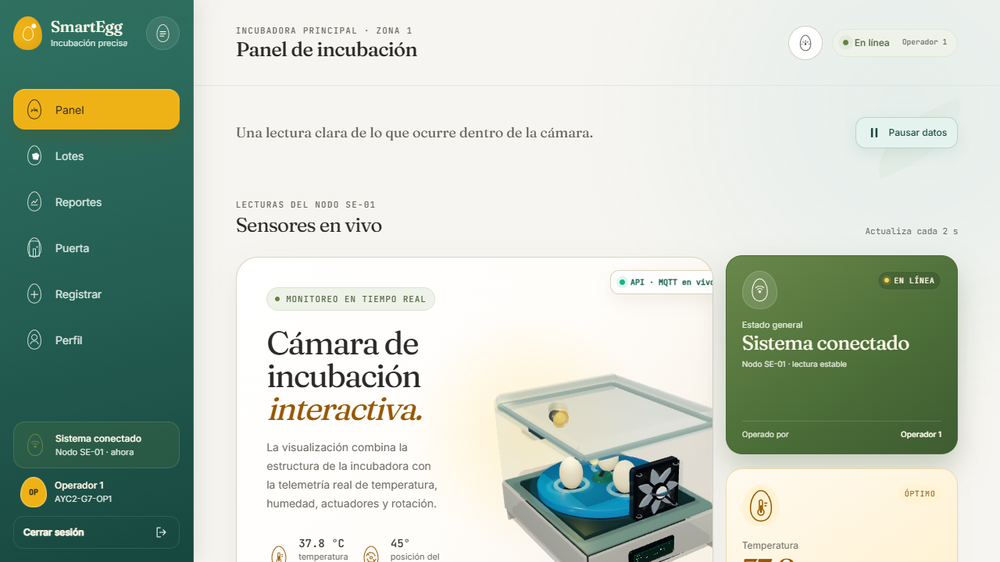

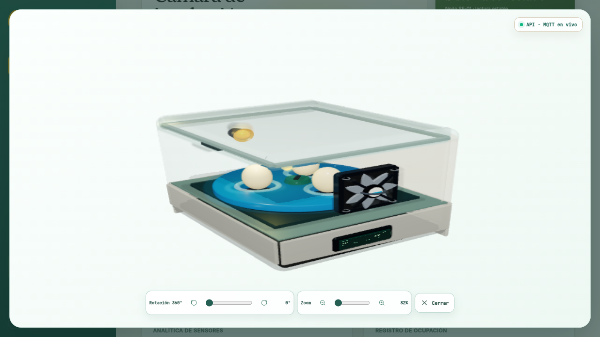

#### Tendencias recientes con Chart.js

Debajo de las tarjetas se muestran dos gráficos:

- **Tendencia de temperatura y humedad relativa:** gráfico de líneas con las últimas lecturas recibidas.
- **Capacidad utilizada en bandeja:** gráfico de barras con la cantidad de huevos ocupados. El valor se obtiene a partir de `3 - espacios_libres`.

Los gráficos muestran las lecturas recientes que llegan por MQTT y se actualizan al recibir nuevos mensajes. Las etiquetas de los puntos muestran la hora de cada lectura cuando el timestamp es válido.

#### Pausar la telemetría

Use **Pausar datos** para detener temporalmente la actualización visual del Panel y examinar los valores actuales sin que cambien. El botón cambia a **Reanudar** para continuar la actualización. Esta acción solo pausa la visualización en el navegador; no detiene el backend, el hardware ni el almacenamiento de lecturas.

### 11.4 Registro y consulta de lotes (`/lotes` y `/lotes/nuevo`)

#### Consultar lotes

1. Seleccione **Lotes** en la navegación.
2. Revise el resumen de capacidad, los espacios ocupados y los espacios libres.
3. Consulte la lista **Lotes recientes**, donde se muestra la etiqueta, identificador, fecha de ingreso, cantidad, temperatura requerida y progreso del ciclo.

#### Registrar un lote

1. Seleccione **Registrar** o el botón **Registrar lote**.
2. Complete la **Etiqueta del lote** con un nombre reconocible.
3. Seleccione la **Fecha de ingreso**. No se permiten fechas posteriores al día actual.
4. Indique la **Cantidad de huevos**, entre 1 y 3, sin superar los espacios disponibles.
5. Especifique la **Temperatura requerida**, entre `36 °C` y `38 °C`.
6. Seleccione **Crear ficha**.

El sistema valida los campos, registra el lote mediante el backend y muestra una ficha de incubación con los datos guardados. Si el disco está lleno o la cantidad supera la capacidad disponible, el registro se rechaza y se muestra el motivo.

**Evidencia de lotes:**

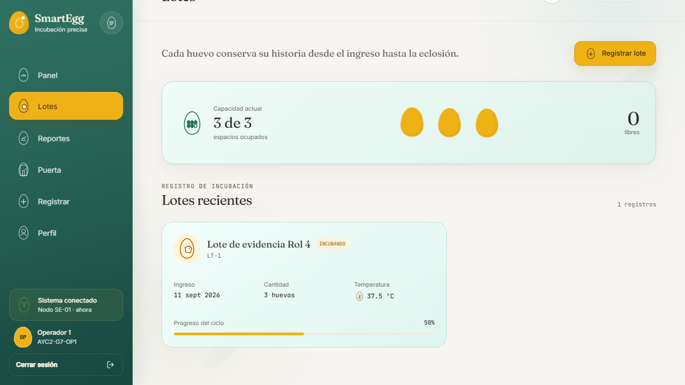

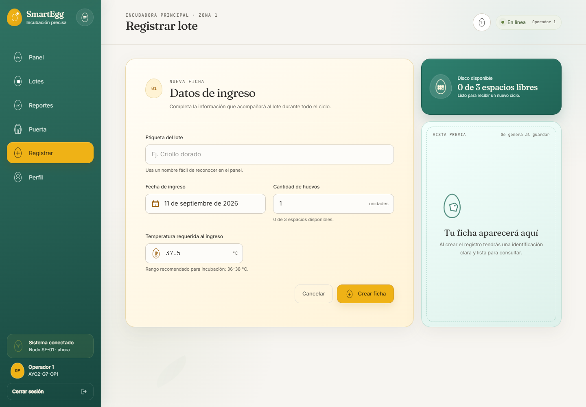

### 11.5 Control de puerta (`/puerta`)

Esta sección está disponible para Operador 1 y Operador 2. El administrador no tiene habilitada la operación física desde este módulo.

1. Ingrese a **Puerta**.
2. Revise el estado actual: **Puerta abierta** o **Puerta cerrada**, junto con la ocupación de la bandeja.
3. Confirme que el nodo esté en línea. Las acciones se deshabilitan cuando no hay conexión.
4. Para abrir la puerta, escriba opcionalmente la cantidad de huevos trasladados, entre 1 y 50, y seleccione **Abrir puerta**.
5. Para cerrar la puerta, seleccione **Cerrar puerta**. La cantidad de huevos no se registra en la operación de cierre.
6. Consulte **Últimos eventos** para verificar el operador, la acción, la cantidad trasladada y la fecha/hora.

Cada acción se envía al endpoint `POST /puerta`, se almacena en la bitácora y se publica como evento MQTT. El historial se consulta mediante `GET /accesos-puerta`.

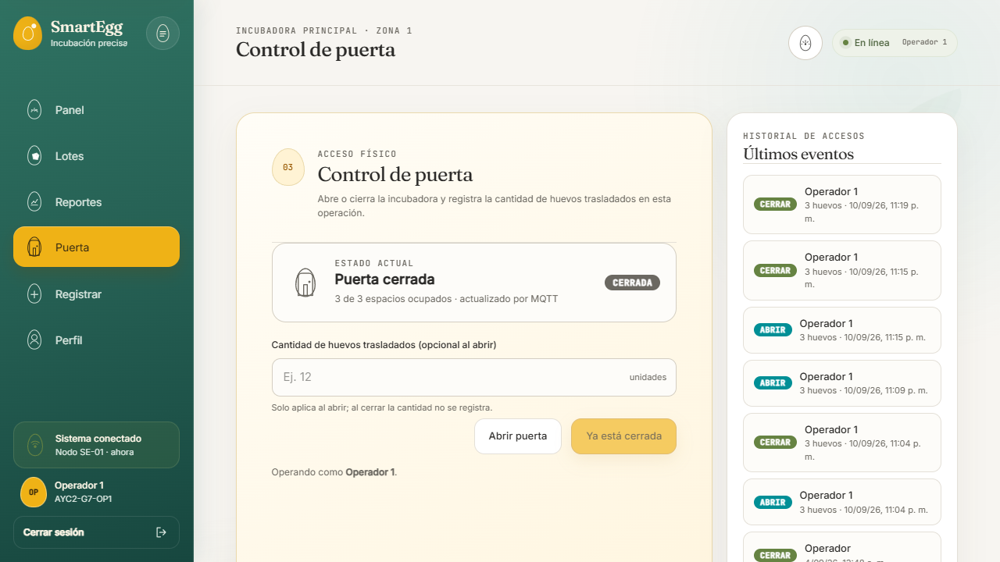

### 11.6 Centro de alarmas y atención de incidentes

El icono de alarma de la barra superior abre el **Centro de alarmas**. Allí se muestran los eventos activos y resueltos, su severidad, descripción y hora.

Cuando llega una alarma nueva:

1. La interfaz muestra el banner **ALARMA ACTIVA**.
2. El icono de alarmas indica la cantidad de eventos sin leer.
3. Se presenta una notificación emergente (*Toast*) y, si el sonido está habilitado, se reproduce una señal audible.
4. En el dashboard p5.js aparece el estado de bloqueo y la acción para solicitar el desbloqueo por MQTT.

Desde el centro de alarmas puede:

- Abrir el panel para revisar los eventos.
- Marcar todas las alarmas como leídas.
- Activar o silenciar el sonido.
- Ocultar el banner visual sin eliminar el registro.

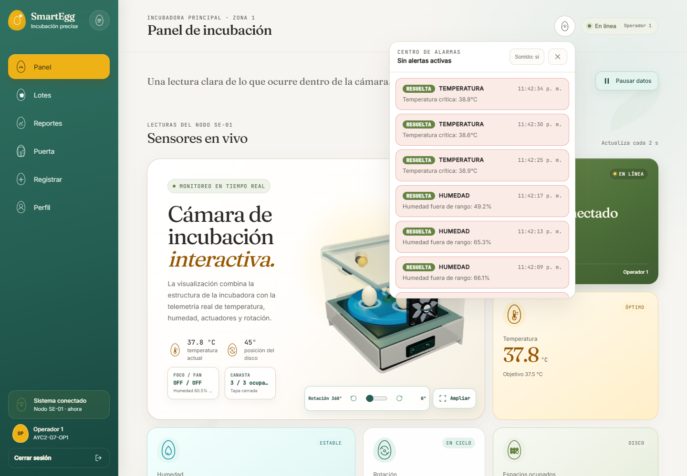

El backend conserva las alarmas con tipo, severidad, mensaje, estado activo, inicio y resolución. La resolución de una alarma depende de que la condición ambiental vuelva al rango configurado por el sistema; ocultar el banner no resuelve la condición física.

### 11.7 Reportes y bitácora (`/reportes`)

La sección **Reportes** presenta un resumen operativo y una bitácora combinada de alarmas y accesos de puerta.

1. Consulte los indicadores de temperatura promedio, humedad media y lecturas procesadas.
2. Revise el historial gráfico de temperatura y la banda de referencia.
3. En **Alarmas y eventos**, use los filtros **Desde**, **Hasta**, **Tipo** y **Severidad**.
4. Seleccione **Limpiar filtros** para volver a mostrar todos los eventos.
5. Use los controles de paginación para recorrer los resultados.
6. Seleccione **Descargar reporte PDF** para generar un informe con texto y datos seleccionables.

El reporte incluye información del operador, lotes, lecturas actuales, alarmas y eventos disponibles para la sesión. El backend también expone `GET /reporte` para generar el reporte PDF consolidado del servicio.

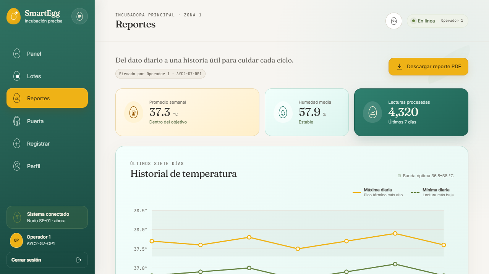

### 11.8 Perfil de usuario (`/perfil`)

En **Perfil**, cada usuario puede consultar:

- Nombre, usuario, rol y distintivo de identificación.
- Temperatura, humedad, estado de la puerta y ocupación actuales.
- Lotes registrados por el usuario. El administrador puede consultar todos los lotes.
- Accesos de puerta asociados al usuario. El administrador puede consultar todos los accesos.
- Estado de conexión del nodo `SE-01`.

Use el enlace **Ir a informes generales** para abrir la sección de reportes.

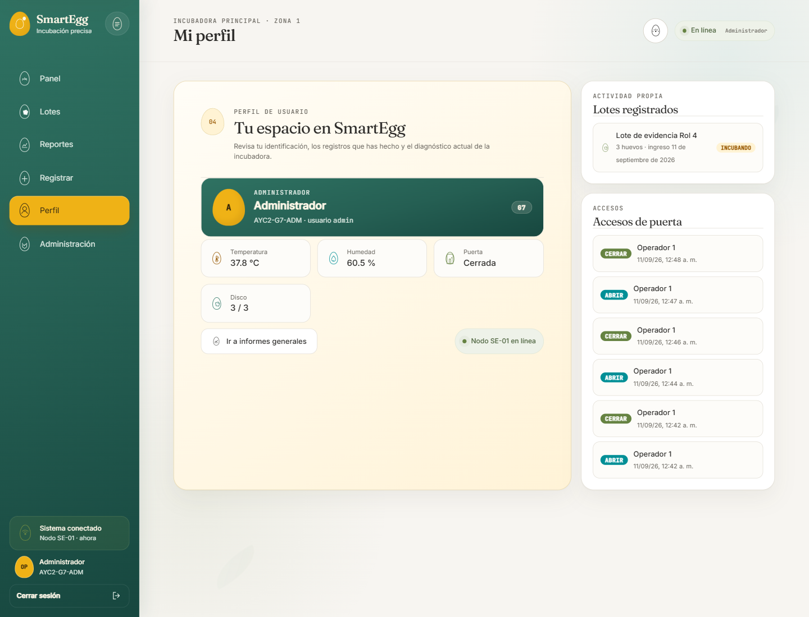

### 11.9 Consola de administración (`/admin`)

La consola está disponible únicamente para el usuario Administrador.

En esta pantalla se pueden consultar:

- Cantidad de lotes registrados y lotes en incubación.
- Alarmas activas.
- Accesos a la puerta y cantidad de aperturas.
- Operadores registrados, con sus lotes y accesos asociados.
- Últimas alarmas, su estado y duración; se muestran cinco por página para facilitar la revisión.
- Últimas aperturas y cierres de puerta.

Use **Actualizar** para volver a consultar la información del backend. Desde el bloque **Grafana** puede abrir `http://localhost:3000` en una nueva pestaña para revisar los dashboards de monitoreo MQTT e histórico.

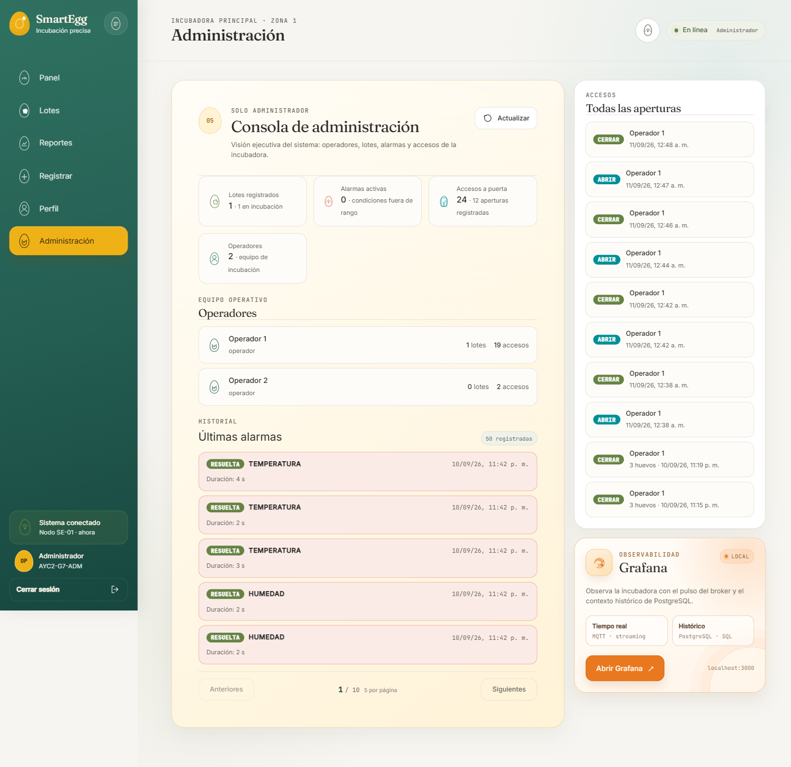

### 11.10 Estados de conexión y solución de problemas

- **Nodo desconectado:** confirme que el backend esté activo y revise `docker compose logs backend`.
- **Sin lecturas:** confirme que el Arduino esté conectado al puente serial, que el puente esté ejecutándose y que el broker MQTT esté disponible. Para pruebas locales, también puede habilitarse el modo simulado.
- **No se puede abrir la puerta:** verifique que el usuario sea un operador y que el nodo aparezca en línea.
- **Gráficos sin datos:** compruebe que el nodo publique telemetría y que el frontend pueda conectarse al broker MQTT por WebSockets (puerto 9001).
- **Grafana no carga:** confirme que el contenedor de Grafana esté activo y que el puerto `3000` no esté ocupado por otro servicio.
- **Acceso denegado a una sección:** cierre sesión e ingrese con el rol requerido. La navegación se filtra automáticamente según los permisos.

### 11.11 Cierre de sesión y buenas prácticas

1. Seleccione **Cerrar sesión** al terminar la operación.
2. No comparta las credenciales entre operadores.
3. Registre correctamente la cantidad de huevos al abrir la puerta.
4. No ignore una alarma activa: revise la causa física en la incubadora.
5. Utilice los reportes y el historial de eventos para documentar las incidencias del ciclo.
