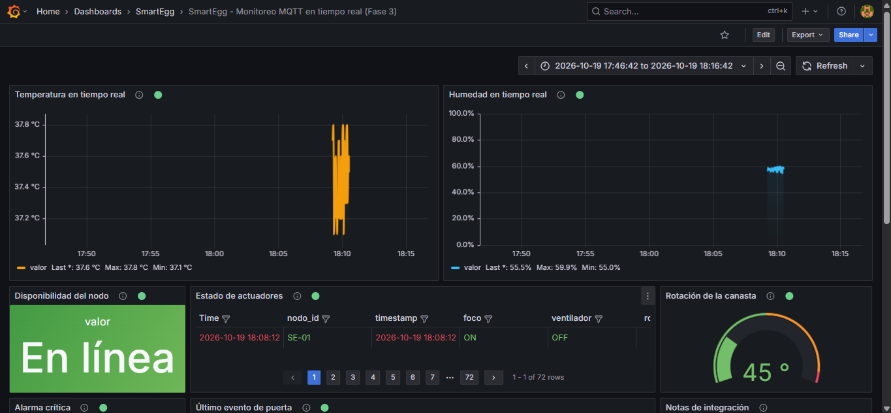
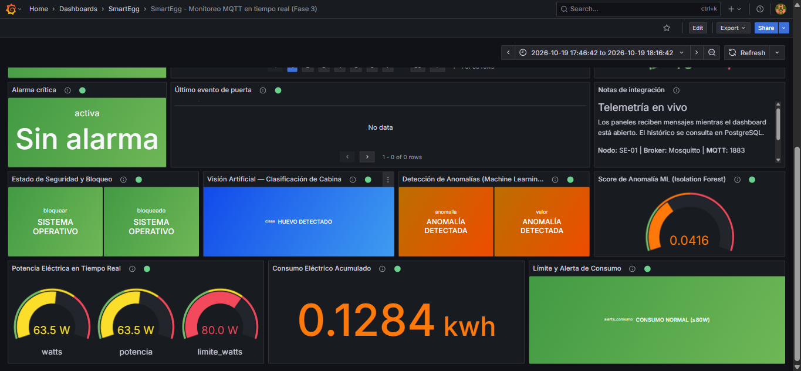
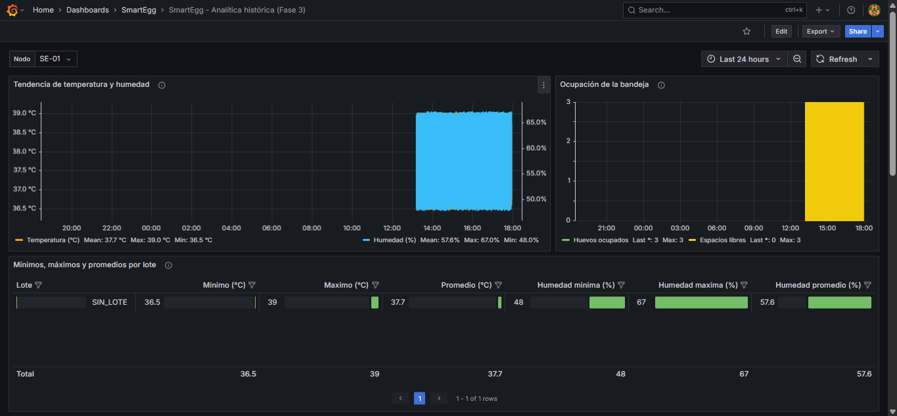
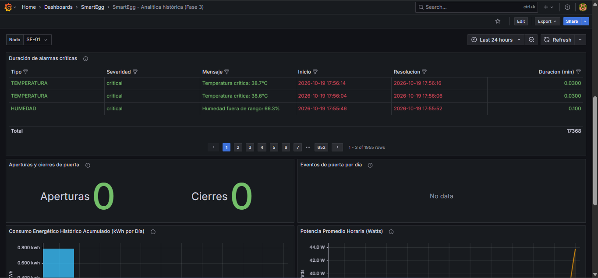
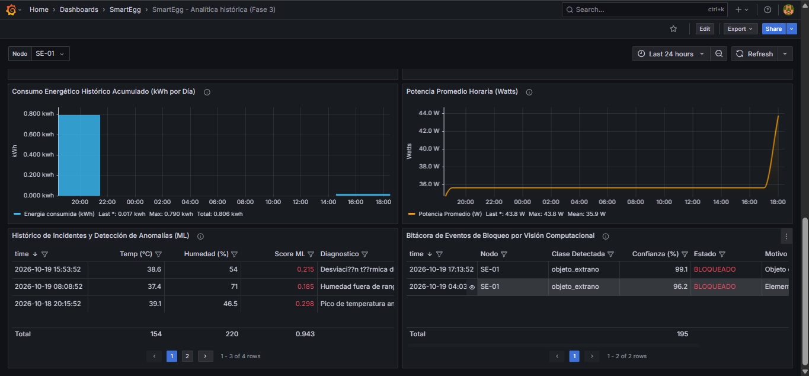
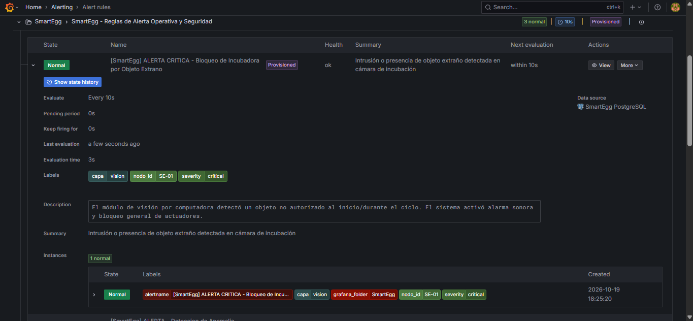
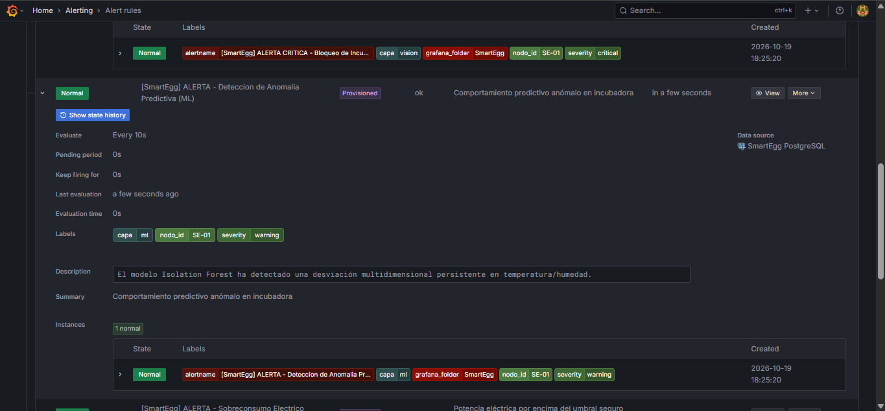
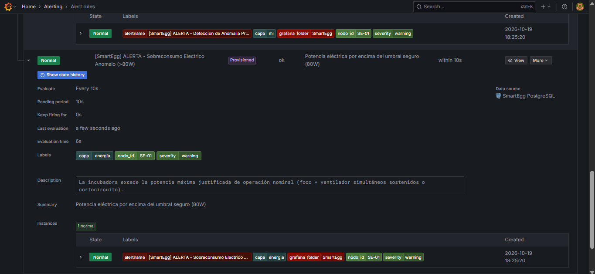
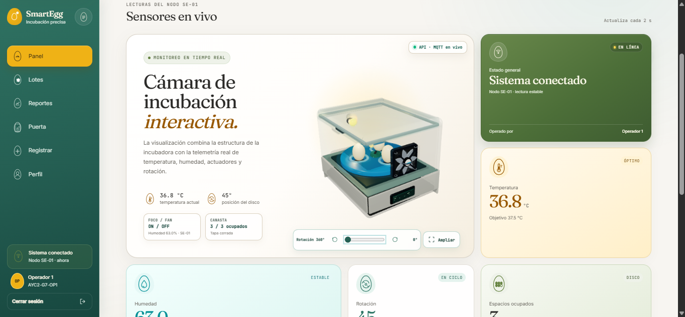
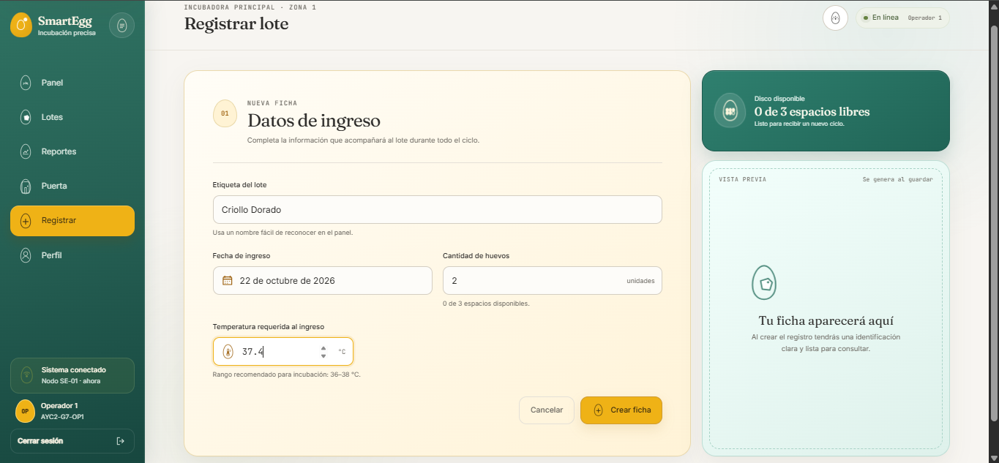

# SmartEgg IoT — Manual de Usuario (Fase 3)

**Universidad de San Carlos de Guatemala**  
Facultad de Ingeniería — Escuela de Ciencias y Sistemas  
Arquitectura de Computadores y Ensambladores 2 — Segundo Semestre 2026  
Catedrático: Ing. Gabriel Alejandro Díaz  
Auxiliares: Josue Antonio Cux Barrientos, Marcos Geovani Josías Pérez Secay  
Grupo: **15**

---

## 1. Introducción y Acceso a la Plataforma

El sistema **SmartEgg IoT (Fase 3)** es una plataforma de incubación avícola inteligente y autónoma que integra percepción visual con inteligencia artificial, mantenimiento predictivo con Machine Learning, gestión de consumo eléctrico en tiempo real y supervisión distribuida en la nube.

### 1.1 Direcciones de Acceso a los Servicios en la Nube y Local
Dependiendo del entorno de ejecución, los servicios se encuentran expuestos en las siguientes direcciones:

| Servicio | Entorno en la Nube (AWS EC2 / Azure VM) | Entorno Local (Docker Desktop) | Protocolo / Puerto |
| :--- | :--- | :--- | :--- |
| **Dashboards en Grafana** | `http://<IP_PUBLICA_NUBE>:3000` | `http://localhost:3000` | HTTP / Puerto 3000 |
| **Dashboard Interactivo p5.js** | `<URL_BUCKET_S3_O_AZURE_BLOB>` | `http://localhost:3001/visualizacion_p5.html` | HTTP / MQTT WebSockets 9001 |
| **Portal Web de Gestión** | `http://<IP_PUBLICA_NUBE>:3001` | `http://localhost:3001` | HTTP / Puerto 3001 |
| **Broker MQTT Eclipse Mosquitto** | `<IP_PUBLICA_NUBE>:1883` (TCP) / `9001` (WS) | `localhost:1883` / `9001` | MQTT TCP / WebSockets |

---

### 1.2 Credenciales de Acceso a Grafana (Rol Evaluador vs Administrador)

Para preservar la integridad de los tableros durante las jornadas de calificación y evaluación presencial, se disponen dos perfiles de acceso:

| Perfil / Destinatario | Usuario | Contraseña | Rol en Grafana | Permisos Asignados |
| :--- | :--- | :--- | :--- | :--- |
| **Docente / Evaluador** ⭐ | **`evaluador`** (o `viewer`) | **`evaluador2026`** (o `viewer123`) | **Viewer (Solo Lectura)** | Navegación completa por paneles, consulta de rangos de fechas, auditoría de alertas. **Protegido contra borrado o edición accidental de paneles.** |
| **Administrador del Sistema** | **`admin`** | **`admin`** | **Admin** | Permisos totales de configuración, aprovisionamiento de datasources y edición de tableros. |

> [!TIP]
> Si el evaluador desea visualizar los dashboards sin iniciar sesión, Grafana cuenta con **acceso anónimo habilitado** en modo Viewer dirigiéndose directamente a la URL pública `http://<IP_PUBLICA_NUBE>:3000`.

---

### 1.3 Credenciales de Acceso al Portal de Gestión Web
El portal web (`:3001`) valida usuarios en base de datos y filtra funciones según el rol:

| Usuario | Contraseña | Rol | Privilegios y Acceso |
| :--- | :--- | :--- | :--- |
| **`admin`** | `admin123` | **Administrador** | Monitoreo en vivo, Lotes, Reportes, Perfil y Consola de Administración completa. |
| **`op1`** | `op1pass` | **Operador 1** | Monitoreo en vivo, Lotes, Registro de Lotes, Control de Puerta, Reportes y Perfil. |
| **`op2`** | `op2pass` | **Operador 2** | Monitoreo en vivo, Lotes, Registro de Lotes, Control de Puerta, Reportes y Perfil. |

---

## 2. Uso e Interpretación de los Dashboards

### 2.1 Dashboard en Grafana: Monitoreo en Tiempo Real (MQTT)
Para ingresar, abre en tu navegador `http://<IP_PUBLICA_NUBE>:3000`, haz clic en **Dashboards** en el menú izquierdo y selecciona **SmartEgg - Monitoreo MQTT en tiempo real (Fase 3)**.

Este tablero se alimenta en streaming de baja latencia directo desde el broker Mosquitto:

```
┌──────────────────────────────────────┬──────────────────────────────────────┐
│  1. Temperatura en Tiempo Real (°C)  │    2. Humedad en Tiempo Real (%)     │
│  [Línea suave - Rango: 37°C a 38°C]  │   [Línea suave - Óptimo: 50% a 65%]  │
├──────────────────┬───────────────────┴───────────────┬──────────────────────┤
│ 3. Estado Nodo   │ 4. Estado Actuadores              │ 6. Rotación Canasta  │
│ [En línea/Verde] │ [Tabla: Foco ON, Fan OFF, Esp: 3] │ [Gauge: 0° a 180°]   │
├──────────────────┼───────────────────────────────────┼──────────────────────┤
│ 5. Alarma        │ 8. Último Acceso Puerta           │ 7. Notas Técnicas    │
│ [Sin Alarma/OK]  │ [Tabla: ABRIR / CERRAR por RFID]  │ [Markdown: Nodo SE01]│
├──────────────────┴───────────────┬───────────────────┴──────────────────────┤
│ 9. Seguridad y Bloqueo           │ 10. Visión IA - Clasificación Cabina     │
│ [SISTEMA OPERATIVO / BLOQUEADO]  │ [HUEVO DETECTADO / OBJETO EXTRAÑO]       │
├──────────────────────────────────┼──────────────────────────────────────────┤
│ 11. Detección de Anomalías (ML)  │ 12. Score de Anomalía ML (IsoForest)     │
│ [COMPORTAMIENTO NORMAL / ANOMALÍA│ [Gauge: -0.2 a 0.5 - Umbral: -0.0052]    │
├──────────────────┬───────────────┴───┬──────────────────────────────────────┤
│ 13. Potencia (W) │ 14. Consumo (kWh) │ 15. Límite de Consumo                │
│ [Gauge: 0 a 120W]│ [Stat: Acumulado] │ [DENTRO DE LÍMITE / SOBRECONSUMO]    │
└──────────────────┴───────────────────┴──────────────────────────────────────┘
```

#### 2.1.1 Interpretación de las Tarjetas de Telemetría Ambiental
* **Temperatura en Tiempo Real (°C):**
  - **Rango Agronómico Óptimo (Verde):** Entre $37.0^\circ\text{C}$ y $38.0^\circ\text{C}$. Es la temperatura ideal de desarrollo embrionario.
  - **Riesgo por Hipotermia (Azul):** Por debajo de $36.0^\circ\text{C}$. El foco se activa forzosamente.
  - **Alarma por Hipertermia (Rojo):** Por encima de $38.5^\circ\text{C}$. Se apaga el foco y se activa el extractor.
* **Humedad en Tiempo Real (%):**
  - **Rango Óptimo:** $50\%$ a $65\%$ de humedad relativa.
  - **Baja Humedad (<45%):** Riesgo de deshidratación de la membrana del huevo.
  - **Exceso de Humedad (>75%):** Riesgo de asfixia o proliferación fúngica.
* **Estado de Actuadores y Mecanismo:**
  - Indica en tiempo real si el **Foco** (`ON`/`OFF`), el **Ventilador** (`ON`/`OFF`) y el **Servomotor** de rotación ($\pm45^\circ$) están activos.
  - **Espacios Libres:** Cantidad de nidos desocupados reportados por los finales de carrera mecánicos ($0$ a $3$).

---

#### 2.1.2 Interpretación de los Diales de Consumo Eléctrico
* **Panel 13 — Potencia en Tiempo Real ($W$):**
  - Medidor de aguja con escala de $0$ a $120\text{ W}$.
  - **Reposo (~3.5 W, Verde):** Electrónica base (Arduino, ESP32, sensores).
  - **Régimen Térmico (~63.5 W, Amarillo):** Foco calefactor de $60\text{ W}$ encendido.
  - **Ventilación / Rotación (~68.5 W - 71 W, Amarillo claro):** Foco + extractor + servomotor.
  - **Sobreconsumo (>80 W, Rojo):** Indica condición anómala o exceso de carga.
* **Panel 14 — Consumo Eléctrico Acumulado ($kWh$):**
  - Contador numérico continuo que integra la energía consumida desde el inicio del lote.
* **Panel 15 — Semáforo de Límite de Potencia:**
  - `DENTRO DE LÍMITE` (Verde `#73BF69`): La potencia instantánea no supera el umbral configurado ($80\text{ W}$).
  - `SOBRECONSUMO ELÉCTRICO` (Rojo `#F2495C`): Exceso de potencia detectado, alertando al operador.

---

#### 2.1.3 Interpretación del Semáforo de Anomalías de Machine Learning
* **Panel 11 — "Detección de Anomalías (ML)":**
  - `COMPORTAMIENTO NORMAL` (Verde `#73BF69`): El vector multivariable [temperatura, humedad, delta térmico, foco, ventilador] coincide con el comportamiento aprendido.
  - `¡ANOMALÍA DETECTADA!` (Rojo `#E02F44`): El modelo *Isolation Forest* identifica un patrón anómalo atípico (descalibración, calentamiento irregular, puerta entreabierta).
* **Panel 12 — "Score de Anomalía ML (Isolation Forest)":**
  - Muestra el valor continuo de puntuación de anomalía emitido por el modelo.
  - **Zona Normal (Score $\le -0.0052$, Verde):** Variabilidad térmica natural.
  - **Zona de Alerta (Score $> -0.0052$, Rojo):** Dispara la alerta predictiva antes de que la temperatura alcance los $38.5^\circ\text{C}$ de la alarma reactiva convencional.
  - **Nota de Operación (Arranque en Frío):** Al encender la incubadora a temperatura ambiente (<30°C), es totalmente normal que marque anomalía durante los primeros 3 a 5 minutos mientras se alcanza el régimen de trabajo.

  
  

---

### 2.2 Dashboard en Grafana: Analítica Histórica (PostgreSQL)
Accede a **SmartEgg - Analítica histórica** en Grafana. Este panel consulta la base de datos relacional y permite auditar:
* **Series Temporales Térmicas:** Doble eje para temperatura y humedad a lo largo de horas o días.
* **Consumo Energético Diario ($kWh$):** Gráfico de barras con el total diario consumido.
* **Potencia Media Horaria ($W$):** Curva suave que muestra los picos horarios de demanda eléctrica.
* **Histórico de Incidentes y Anomalías (ML):** Bitácora cronológica con fecha, temperatura, humedad, score de anomalía y diagnóstico predictivo.
* **Bitácora de Eventos de Bloqueo por Visión Computacional:** Tabla de auditoría con la fecha, el objeto detectado, el nivel de certeza (%) y los segundos que el sistema permaneció deshabilitado.

  
   
  

---

### 2.3 Supervisión de Reglas en Grafana Alerting
En el menú lateral de Grafana, ingresa a **Alerting** $\to$ **Alert rules**:
* **`[SmartEgg] ALERTA CRITICA - Bloqueo de Incubadora por Objeto Extrano`:** Se dispara si se detecta un objeto no autorizado en la cabina.
* **`[SmartEgg] ALERTA - Deteccion de Anomalia Predictiva (ML)`:** Se dispara cuando el modelo predictivo detecta un comportamiento anómalo.
* **`[SmartEgg] ALERTA - Sobreconsumo Electrico Anomalo (>80W)`:** Se dispara si la potencia supera el umbral de seguridad.
* **Estados:**
  - **Normal (Verde):** Parámetros seguros (`Health: ok`).
  - **Firing (Rojo):** Regla detonada, despachando notificación visual en la interfaz.

  
  
  

---

### 2.4 Dashboard Interactivo en p5.js
Alojado como sitio web estático en la nube (AWS S3 Bucket o Azure Blob Storage), este tablero interactivo se conecta al broker MQTT mediante WebSockets (`ws://<IP>:9001`):
1. **Renderizado en Tiempo Real:** Visualiza la bandeja física oscilando a $\pm45^\circ$, el resplandor animado del foco incandescente cuando está en `ON`, la animación rotatoria del ventilador y el nivel de humedad con un sistema de partículas.
2. **Diales Digitales de Energía:** Presenta la potencia instantánea ($W$) y la energía acumulada ($kWh$).
3. **Controles de Parámetros:** Incluye controles interactivos para fijar el límite máximo de potencia y programar temporizadores de operación.



---

## 3. Protocolo Operativo ante Bloqueo del Sistema (Valor Disruptivo)

### 3.1 ¿Qué sucede durante un Incidente de Bloqueo?
Si la cámara de inspección detecta una tijera, pinza, herramienta, plástico o cualquier objeto ajeno al iniciar el ciclo de incubación:

#### A. Reacción Física Instantánea en la Incubadora (< 200 ms):
* **Corte Térmico Inmediato:** El relé del foco calefactor se abre forzosamente (**Foco OFF**), eliminando cualquier riesgo de calentamiento sobre el objeto intruso.
* **Desconexión del Extractor:** El relé del ventilador se apaga (**Fan OFF**).
* **Alarma Sonora:** El buzzer físico (Pin 8) emite un tono de advertencia continuo de alta frecuencia.
* **Alarma Luminosa:** El LED rojo de emergencia (Pin 13) se ilumina de forma permanente.
* **Pantalla LCD 16x2:** Cambia de inmediato su texto por el mensaje de alerta:
  ```text
  !BLOQUEO VISION!
  OBJETO INVALIDO
  ```

#### B. Reacción Visual en la Web y Dashboards:
* **Grafana:** El panel 9 cambia instantáneamente a fondo rojo `#F2495C` con el texto `SISTEMA BLOQUEADO (OBJETO EXTRAÑO)` y el panel 10 muestra `¡OBJETO EXTRAÑO!`.
* **Grafana Alerting:** La regla de alerta crítica entra en estado **Firing** (ícono de fuego rojo).
* **Dashboard p5.js:** La pantalla interactiva se cubre con un overlay rojo de emergencia, emite una advertencia visual parpadeante y deshabilita todos los controles de los actuadores.
* **Base de Datos:** Se inserta automáticamente un registro forense en la tabla `eventos_seguridad_vision` auditando la fecha, objeto, certeza y estado.

---

### 3.2 Protocolo de Desbloqueo y Reanudación Segura
Para reanudar la incubación, el operador debe seguir obligatoriamente este procedimiento:
1. **Inspección Física:** Acercarse físicamente a la incubadora y abrir la cabina de incubación.
2. **Retiro del Objeto Extraño:** Extraer el objeto ajeno detectado (herramienta, tijera, plástico, etc.).
3. **Verificación Visual:** Confirmar que en la bandeja reposen únicamente huevos fértiles autorizados o que la bandeja se encuentre debidamente despejada.
4. **Enviar Orden de Desbloqueo:**
   - **Opción A (Desde la Consola de Visión OpenCV):** Presionar la tecla **`[R]`** en la ventana de OpenCV para enviar la orden de reintento/desbloqueo.
   - **Opción B (Mediante MQTT):** Publicar un mensaje MQTT en el tópico de control:
     * **Tópico:** `smartegg/SE-01/control/bloqueo`
     * **Payload:** `{"nodo_id": "SE-01", "bloquear": false, "motivo": "desbloqueo_manual_operador"}`
5. **Reanudación del Sistema:** El buzzer se silenciará, el LED rojo se apagará, la pantalla LCD volverá a exhibir temperatura y humedad, los paneles de Grafana y p5.js volverán a su estado operativo verde normal y los actuadores se rehabilitarán.

---

## 4. Gestión de Consumo Eléctrico: Horarios, Temporizadores y Límites

El sistema integra un módulo integral de gestión energética para supervisar el costo operativo y prevenir incidentes eléctricos:

### 4.1 Horarios y Ciclos de Operación de Actuadores
El operador puede consultar en los dashboards el comportamiento de ciclo de cada componente:
* **Foco Calefactor (60 W):** Opera bajo control termostático por histéresis. Se enciende cuando la temperatura cae por debajo de $37.0^\circ\text{C}$ y se apaga al alcanzar $37.8^\circ\text{C}$. Su ciclo de trabajo promedio es de 15 a 20 minutos por hora en cabina aislada.
* **Ventilador Extractor (5 W):** Se activa únicamente si la temperatura sobrepasa los $38.5^\circ\text{C}$ para disipar calor residual, o en ciclos periódicos de renovación de aire de 30 segundos cada 3 horas.
* **Servomotor de Volteo (2.5 W):** Ejecuta una oscilación angular lenta ($\pm45^\circ$) cada 60 segundos durante los primeros 18 días del ciclo de incubación para evitar que el embrión se adhiera a la membrana de la cáscara. Permanece en reposo los últimos 3 días (fase de eclosión).

---

### 4.2 Configuración y Monitoreo de Límites de Consumo
* **Límite de Potencia por Defecto:** Está establecido en **$80.0\text{ W}$**, suficiente para la operación simultánea de foco ($60\text{ W}$), ventilador ($5\text{ W}$), servomotor ($2.5\text{ W}$) y lógica base ($3\text{ W}$).
* **Ajuste de Límite desde p5.js:** Mediante el slider interactivo de potencia en la interfaz p5.js, el operador puede calibrar el umbral entre $50\text{ W}$ y $120\text{ W}$.
* **Ajuste vía Tópico MQTT:**
  - **Tópico:** `smartegg/SE-01/control/energia`
  - **Payload:** `{"limite_watts": 85.0, "temporizador_minutos": 60}`
* **Reacción ante Sobreconsumo:** Si la potencia supera el límite fijado durante más de 10 segundos continuos (por ejemplo, si se instala por error una lámpara de 100W o si ocurre un cortocircuito parcial), el sistema activa el panel de `SOBRECONSUMO ELÉCTRICO` en rojo en Grafana y puede forzar el corte preventivo de calefacción.

---

### 4.3 Temporizadores de Corte y Mantenimiento Programado
Para labores de ovoscopía, calibración o desinfección programada, el operador puede programar un temporizador de desconexión preventiva:
* Desde la interfaz p5.js o cliente MQTT, se define el parámetro `temporizador_minutos` (ej. 30 minutos).
* El gestor de energía inicia una cuenta regresiva. Al finalizar el tiempo estipulado, el sistema emite una orden de reposo a los actuadores térmicos para permitir la intervención manual segura del técnico avícola.

---

## 5. Uso del Panel de Administración y Aplicación Web

### 5.1 Monitoreo en Vivo (`/dashboard`)
* Concentra los indicadores ambientales en tiempo real, estado del nodo y ocupación de la bandeja.
* Permite pausar visualmente el flujo de datos con el botón **Pausar datos** para inspeccionar una lectura fija sin alterar el registro en la base de datos.

### 5.2 Registro y Control de Lotes (`/lotes` y `/lotes/nuevo`)
1. Ingresa a la sección **Lotes** del menú superior.
2. Para dar de alta una nueva tanda de huevos, haz clic en **Registrar lote**:
   - Ingresa una **Etiqueta** descriptiva (ej. `Lote Incubación Raza Leghorn - Tanda 04`).
   - Define la **Fecha de ingreso** (no se admiten fechas futuras).
   - Especifica la **Cantidad de huevos** ($1$ a $3$ según capacidad física).
   - Fija la **Temperatura requerida** (rango agronómico: $36.5^\circ\text{C}$ a $38.0^\circ\text{C}$).
   - Haz clic en **Crear ficha**. El lote quedará persistido en PostgreSQL y vinculado a las lecturas y consumo energético.



### 5.3 Generación y Descarga de Reportes PDF (`/reportes`)
1. Ve a la sección **Reportes**.
2. Filtra la bitácora histórica por rango de fechas (**Desde** / **Hasta**) o por severidad de alarma.
3. Haz clic en **Descargar reporte PDF**:
   - El backend compilará al vuelo un documento formal en PDF con encabezados institucionales de la USAC, identificación del operador, resumen térmico, balance de consumo de energía, listado de anomalías ML y bitácora de accesos RFID.

### 5.4 Consola de Administración (`/admin`)
* Reservada exclusivamente para el usuario `admin`.
* Permite auditar la cantidad total de lotes registrados, alarmas activas, accesos a puerta por RFID y el listado de operadores autorizados con sus respectivas marcas de tiempo.

---

## 6. Accionamiento de Actuadores (Exclusivamente por MQTT)

> [!IMPORTANT]
> El sistema cumple con la directiva de control de actuadores **únicamente a través de tópicos MQTT**, eliminando cualquier endpoint REST de control directo:

### 6.1 Apertura y Cierre de Puerta
* **Accionamiento Físico (RFID):** El operador acerca el llavero autorizado al lector RC522. El microcontrolador valida el UID (`31 FB F3 4C`), destraba el servomotor a $90^\circ$, emite un pitido de confirmación y publica el evento en `smartegg/SE-01/puerta/evento` con `{accion: "ABRIR"}`. Tras 5 segundos, la puerta se cierra automáticamente emitiendo `{accion: "CERRAR"}`.
* **Control Digital por MQTT:** Para abrir la puerta desde una terminal o script autorizado, se publica un mensaje MQTT:
  - **Tópico:** `smartegg/SE-01/control/puerta`
  - **Payload:** `{"nodo_id": "SE-01", "accion": "ABRIR", "operador_id": 1}`

### 6.2 Control del Ciclo de Incubación
* El ciclo de incubación se activa o desactiva mediante publicación MQTT:
  - **Tópico:** `smartegg/SE-01/ciclo/control`
  - **Iniciar ciclo:** `{"nodo_id": "SE-01", "activo": true}`
  - **Detener ciclo:** `{"nodo_id": "SE-01", "activo": false}`
* Al iniciar el ciclo, la cámara OpenCV vigila la bandeja. Si detecta un objeto no autorizado, se desencadena el protocolo de bloqueo automático.

---

## 7. Resolución de Problemas Frecuentes

| Síntoma | Posible Causa | Acción Correctiva |
| :--- | :--- | :--- |
| **Grafana muestra paneles en "No Data"** | No se han generado lecturas o no se corrió el seed inicial. | Ejecutar en la VM: `Get-Content infra/sql/seed_datos_fase3.sql -Raw \| docker compose exec -T postgres psql -U smartegg -d smartegg`. |
| **La cámara clasifica como "vacío" teniendo huevos** | Iluminación deficiente o cámara desalineada de la ROI. | Asegurar que la cámara apunte directamente a la bandeja oscilatoria y que la iluminación interna permita distinguir los bordes. |
| **El túnel serial no conecta con el broker** | IP pública de la nube incorrecta o puerto 1883 cerrado en firewall. | Verificar en AWS Security Groups o Azure Network Security Group que los puertos `1883 TCP` y `9001 TCP` estén abiertos a `0.0.0.0/0`. |
| **Frontend sin lecturas o gráficos vacíos** | El puente serial no está corriendo o el frontend no llega a WebSockets. | Confirmar que el Arduino esté conectado al host, ejecutar `python backend/serial_bridge.py` y comprobar que el puerto 9001 WS esté accesible. |
| **El buzzer suena continuamente al encender** | El sistema arrancó en estado de bloqueo previo retenido en MQTT. | Pulsar la tecla `[R]` en la consola de visión o publicar `{bloquear: false}` en `smartegg/SE-01/control/bloqueo`. |
| **El modelo ML marca anomalía al arrancar** | **Comportamiento esperado (Arranque en frío):** La cabina está a temperatura ambiente (<30°C) y no a los 37.5°C de régimen. | Esperar entre 3 y 5 minutos a que la incubadora alcance su temperatura de consigna; el semáforo se normalizará a verde automáticamente. |
